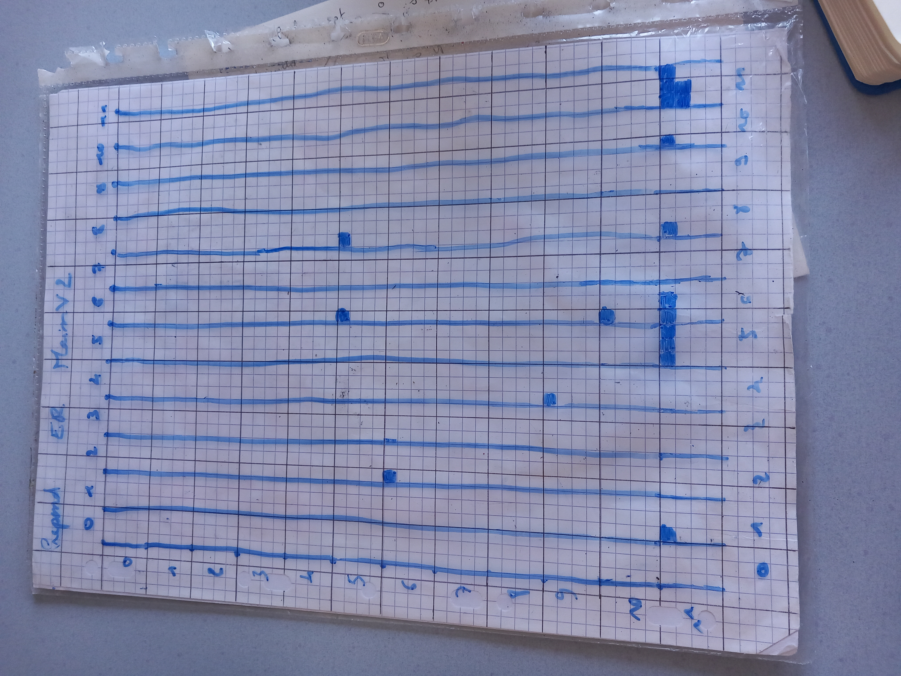
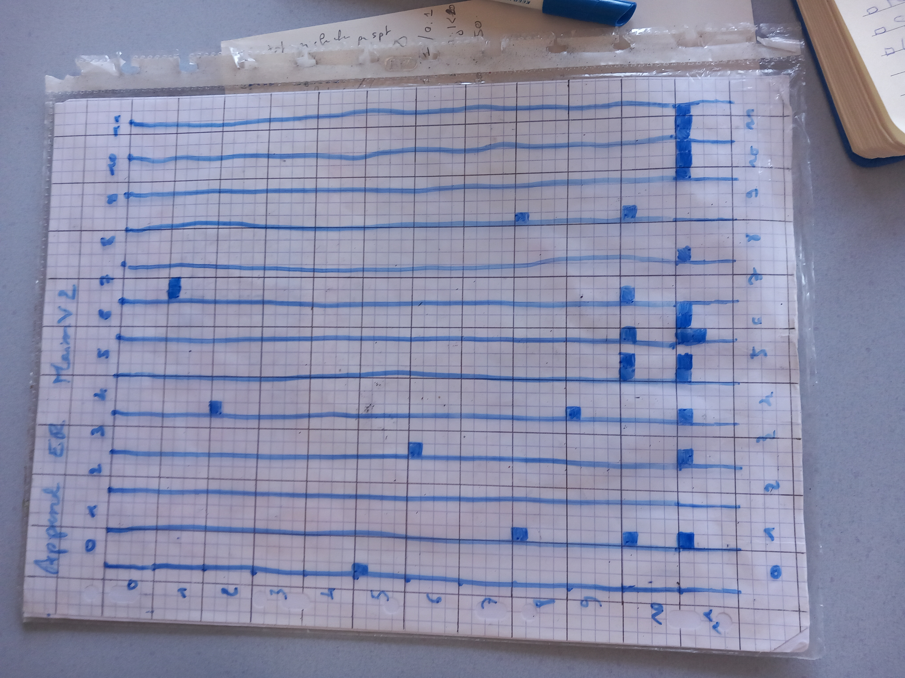

# Elephant rose sur un dataset défense à une question 

## Contexte
Semaine du 16 juin
mirev42
Effectué avec GenericAutomatedPertubation.py
Dans le k de la matrice de sensibilité, les NaN sont remplacés par 0


## Dataset défense fait main V2 

Construction des données:
- 1 question, 3 pdf (limitations matérielles du drone, code de la défense - matériel de guerre, fausses infos pdt les JO/JP)
- 50% de textes pertinents
- 28 paires

Question : 
> Quelles sont les trois principales catégories de limitations techniques affectant les systèmes de drones, et comment chacune influence-t-elle l'efficacité opérationnelle de ces vecteurs ?


|word      | freq | TF-IDF |
|----------|---|------------------|
|**matériel**  |16 |0.0627430130086598|
|**système**   |11 |0.0542242908052481|
|**limitation**|6  |0.0495565089630139|
|**drone**     |10 |0.0441649020535004|
|défense   |10 |0.0440955901918619|
|prendre   |6  |0.0425658179515979|
|compte    |5  |0.0404563824330286|
|action    |8  |0.0401684995180441|
|article   |9  |0.0400092952253956|
|ministre  |8  |0.03913497111578  |
|aérien    |7  |0.0366033210120314|
|acteur    |6  |0.0337084867312698|
|guerre    |8  |0.0336043799517422|


## Perturbations

Construction des perturbations

Choix des mots à remplacer:
- fréquence et TF-IDF des documents
- contenu de la question

Choix des mots éléphants roses utilisés:
- aléas de nos pensées avec jugement qualitatif de la proximité entre le mot et le contexte du dataset
- combinaison de mot improbable et mots improbable dans ce contexte individuellement, tentative de maintien d'un groupe de mot de même classe grammaticale


Perturbations replace:
``` 
matériel -> porte sans poivre
système -> esperluette en vent
drone -> ver de verre
défense -> poire retrournée
article -> saucisson bois
technique -> retourné vert
aérien -> presque rien
limitation -> feuille tissu
```

Perturbations append et prepend
```
+porte sans poivre
+esperluette en vent
+ver de verre
+poire retrournée
+saucisson bois
+retourné vert
+presque rien
+feuille tissu

porte sans poivre+
esperluette en vent+
ver de verre+
poire retrournée+
saucisson bois+
retourné vert+
presque rien+
feuille tissu+
```


## Résultats et analyse
### Perturbations de type replace
`article -> saucisson bois`
- perturbation de l'espace quasi absente
- 3 noeuds réactifs malgré tout ((11,1), (11,3), (10,11)) 
    - variation significative en moyenne
    - écarts-types plus importants
- (10,5), (11,5), (1,7) peut-être intéressants aussi

`défense -> poire retournée`
- perturbation quasi absente
- 2 noeuds faiblement réactifs mais remarquables ((1,7) à -0,30 et (11,10) à 0.27)
- Effect du rescaling interssant à observer
    - certains écrats-types sont finalement écartés
    - certaines moyennes qui ne ressortaient pas apparaissent

`matériel -> porte sans poivre`
- impact de perturbation quasi nul
- sensibilité du modèle idem
- 3312 NaN remplacés (82% des scores de perturbation de noeud)
$\Rightarrow$ Malgré des scores de perturbation faible, on trouve **parfois** quelques noeuds même si ils sont moins marqués

`technique -> retourné vert`
- impact nul de la perturbation sur les distances
- Peut-être un noeuds remarquable : (11,5) à 0.19 +/- 1.00
=> Des sensibilités à une perturbation qui ne change pas l'espace de représentation

`système -> esperluette en vent`
- Perturbation de l'espace faible mais non-nul
- 2 ou 4 noeuds à observer
    - (11,1) à 0.82 +/- 2.57
    - (11,5) à -0.78 +/- 2.49
    - (11,11) à 0.52 +/- 1,75
    - (1,7) à 0.35 +/- 1,61

`drone -> ver de verre`
- Perturbation de l'espace OK
- 1 noeud (éventuellement) remarquable : (11,4) à 0.24 +/- 0.44

### Perturbations de type append
Pas de perturbation de l'espace très flagrante MAIS cela n'empèche pas des sensibilité de composant parfois très importante (`+saucisson bois`) comme plus raisonnable (`+porte sans poivre`)  

`+esperluette en vent`
- espace de représentation : OK
- (11,5) 0.99 +/- 5.52
- (10,5) 0.61 +/- 3.00
- (10,7) 0.54 +/- 3.61 ??

`+feuille tissu`
- perturbation de l'espace OK
- (11,11) 4.03 +/- 12.69
- (11,8) -2,67 +/- 11,65
- (2,4) 1,90 +/- 6,41 ?? (47% +/- 50%)

`+poire retournée`
- perturbation de l'espace OK
- (11,10) -4,23 +/- 15.17
- (10,1) 1,77 +/- 7,24 (42% +/- 48%)

`+porte sans poivre`
- perturbation de l'espace OK
- (11,6) 0.45 +/- 0.52
- (11,3) 0.34 +/- 0.28 
- (11,4) 0.32 +/- 0.23
- (8,9) -0.31 +/- 0.40
- (10,5) 0.20 +/- 0.30 (44%, 49%)


`+ presque rien`
- perturbation de l'espace bof
- (1,7) 0.82 +/- 2,95
- (11,10) 0.70 +/- 3,49
- (11, 11) 0.59 +/- 1,56 (72% +/- 45%)
- (6,3) -0.58 +/- 2,72 (-71% +/- 79%)
- (10,6) -0.50 +/- 2.56 (-60% +/- 73%)


`+ vers de verre`
- perturbation de l'espace OK
- (11,6) -4,29 +/- 12,70
- (8,1) -3.00 +/- 17,26
- (5,0) -2,21 +/- 12,91 (-50% +/- 75%)
- (10,9) -1,33 +/- 11,18 (-46% +/- 65%)
- (1,7) -1,98 +/- 10,46 (-45, 61%)

`+ sucisson bois`
- perturbation de l'espace bof
- perturbations énomre , ecarts-types encore plus
- (11,1) 46,10 +/- 238,21 
- (11,5) -35,30 +/- 186,09
- (11,9) 20,03 +/- 105,90 (43%, 44%)

`+ retourné vert`
- perturbation de l'espace Ok
- (11,5) -0.74 +/- 3,34
- (11,6) 0.73 +/- 1,62
- (9,4) 0.47 +/- 0.89 (64%, 25%)
- (11,11) 0.43 +/- 1,1 (58%, 31%)
- ...
- (8,9) 0.1 +/ 2,69 (14%, 76%)
- (9,7) -0.07 +/- 2,11 (-1%, 60%)
- (9,10) 0.35 +/- 1,99 (48%, 56%)

### Perturbation de type prepend
`esperluette en vent+`
- perturbation de l'espace
- (5,8) 1,56 +/- 7,88
- (5,6) -1 +/- 5,17
- (11,6) 0.80 +/- 4,25 (51% , 54%)
- ...
- (1,7) 0.51 +/- 5,54 (33%, 70%)
- (11,5) -0.08 +/- 4,97 (-5%, 63%)
- (9,10) 0.41 +/- 4,56 (37%, 58%)

`tissu+`
- perturbation espace Ok
- perturbation des composant importante et certains écarts-types très importants
- (11,11) 12,51 +/- 67.07
- (11,8) -9,15 +/- 51,64
- (11,1) - 7,77 +/- 42,37
- (11,9) 5,20 +/- 27,83 (42%, 42%)

`vert+`
- perturbatoin de l'espace OK
- (11,11) 1,41 +/- 0.80
- (11,5) -1,15 +/- 0.84

`presque rien+`
- (11,6) 1,34 +/- 6,75
- (11,11) -0.82 +/- 7,48
- (10,6) 0.68 +/- 3,63
- (9,4) 0.46 +/- 3,18 (35, 42)
- (6,2) 0.47 +/- 1,91 (35, 26)

`retourné vert+`
- (11,11) 1,14 +/- 0.8
- (11,5) -1,15 +/- 0.84
- ...
- (11,6) -0.33 +/- 0.52 (-23%, 62%)
- (2,5) -0.04 +/- 0.44 (-3%, 52%)

`ver de verre+`
- perturbation de l'espace modéré
- (11,5) -4,52 +/- 3,09
- (11,11) 3,85 +/- 9,52

=> (11,5) et (11, 11) sont très présents dans les perturbations de type prepend. On les retourve aussi dans les perturbations append mais c'est moins marqué


