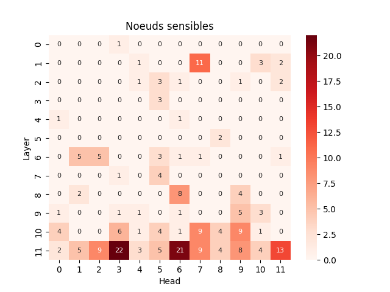
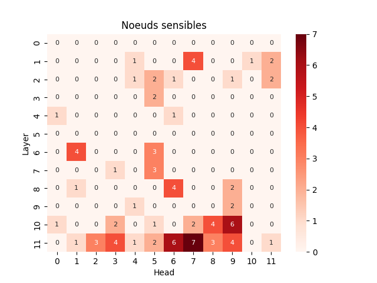
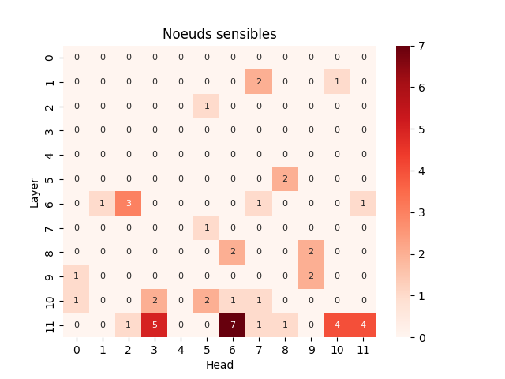
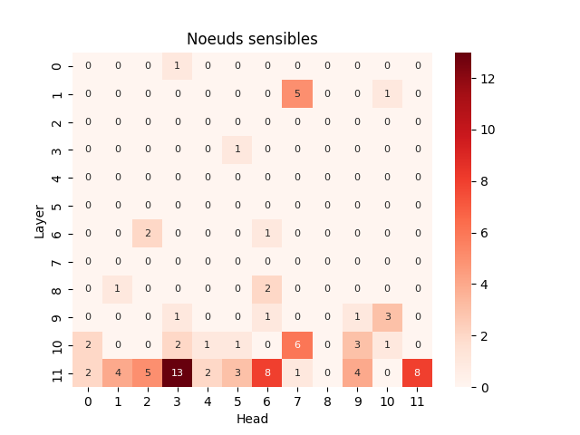

# Replace, Append et Prepend sur un dataset défense à une question 

## Contexte
Semaine du 15 juin
mirev42
Effectué avec GenericAutomatedPertubation.py
Dans le k de la matrice de sensibilité, les NaN sont remplacés par 0


## Dataset défense fait main V3
### Question
1 question : 
> Quels sont les défis majeurs liés à l’utilisation d’une intelligence artificielle auto-apprenante dans les systèmes d’armes, et en quoi ces défis remettent-ils en cause les méthodes traditionnelles de développement et de validation des technologies militaires ?

### Thématique
Sujet pas spécifique à la défense mais appliqué à la défense : Intelligence Artificielle appliquée aux outils et pratiques de la défense et notamment à la guerre.

Thèmatique des 3 pdf:
- IA pour la défense : enjeux
- Aviation civile
- usage des ballons (aérostats et dirigeables) dans l'histoire et rebond de l'usage

### Statistique
| Mot     | Fréquence| TF-IDF         |
|------------|---|--------------------|
|système     |13 |0.06480086088326986 |
|transport   |9  |0.05957370634266266 |
|militaire   |9  |0.0488148141908528  |
|force       |8  |0.048789708865220195|
|aérien      |8  |0.05223144426877953 |
|automatiser |7  |0.04028923862758367 |
|artificiel  |6  |0.04046189336007796 |
|intelligence|6  |0.04046189336007796 |
|emploi      |6  |0.03775763430881781 |
|domaine     |6  |0.03862181838643274 |

_Système_ est essentielement issu de l'expression _système autonome_ dans les documents positofs (issus du numéro sur l'emploi des Ia et systèmes automatisés du Centre interarmées de concepts, de doctrines et d’expérimentations). La seule exception est pour _système High Altitude pseudo-satellite (HAPS)_ issu du document sur les ballons.

L'entièreté des occurences de _transport_ sont issues du document sur l'aviation civile.

Les occurences de _militaire_ sont issues des documents sur les sytèmes autonomes et les ballons.

## Perturbations

Construction des perturbations:
- fréquence et TF-IDF des documents
- contenu de la question

Perturbation qui visent la langue de spécialité (synonyme du sens de la langue courante)

```
système -> doctrine
système -> équation
système -> problème
système -> institution
système -> instance
+système
système+

transport -> acheminnement
transport -> élan
transport+
+transport

aérien -> léger
aérien -> souple
+aérien
aérien+

militaire -> discipliné
militaire -> soldat
militaire+
+militaire

force -> vigueur
force -> résistance
force -> contrainte
force -> niveau
+force
force+

artificiel -> faux
artificiel -> feint
artificiel+
+artificiel

intelligence -> maitrise
intelligence -> compréhension
intelligence+
+intelligence

automatiser -> systématiser
automatiser+
+automatiser

défi -> provocation
défi -> enjeux
+défi
défi+

```

## Résultats et analyse
### Noeuds remarquables






### Perturbations de type append
Perturbation de l'espace pas variables :
- le plus : +automatiser, +aérien, +militaire
- moyen : +défi, +transport, +système, +intelligence
- le moins : +artificiel, +force, 

Nombre de noeuds relevés par perturbation:
+porte sans poivre : 17
+esperluette en vent : 5
+ver de verre : 6
+poire retrournée : 1
+saucisson bois : 2
+retourné vert : 8
+presque rien : 10
+feuille tissu : 3

### Perturbation de type replace
3 perturbation à impact NUL : automatiser -> systématiser, défi -> enjeux, défi -> provocation

Transformations de l'espace relativement faibles pour les autres.

Pour autant, certaines perturbations ont tout de même un impact sur certains noeuds (parfois peu):


transport -> acheminnement : 10
transport -> élan : 9
système -> institution : 8
force -> contrainte : 7
système -> doctrine : 6
système -> instance : 6
système -> problème : 5
force -> résistance : 5
aérien -> léger : 5
système -> équation : 4
force -> vigueur : 4
intelligence -> maitrise : 4
force -> niveau : 3
artificiel -> faux : 3
artificiel -> feint : 2
intelligence -> compréhension : 2
aérien -> souple : 1
militaire -> discipliné : 1
militaire -> soldat : 1
automatiser -> systématiser : 0
défi -> provocation : 0
défi -> enjeux : 0

**Interpretation** : Les transformations à 0 noeud sensible sont des synonymes du sens utilisé. Mais certaines transformation qui impactent beaucoup de noeuds aussi. Le nombre de noeuds impacté conserve la proximité des mots remplacés (les deux replace de défi sont à 0 alors que les 2 replace de transport sont à 9 et 10)

### Perturbation de type prepend
Impact de la perturbation sur l'espace de représentation:
- peu (`artificiel+`, `défi+`, `force+`)
- modéré (`transport+`, `intelligence+`)
- fort (`militaire+`, `automatiser+`, `aérien+`)

Nombre de noeuds sensibles à la perturbation:
force+ : 11
automatiser+ : 10
système+ : 8
artificiel+ : 7
militaire+ : 5
transport+ : 3
intelligence+ : 3
aérien+ : 2
défi+ : 1

**Analyse**:
- pas de correlation entre perturbation de l'espace et nombre de noeuds sensible
- les mots qui impactent le plus de noeuds sont absent de la question (On s'en fout non?)

