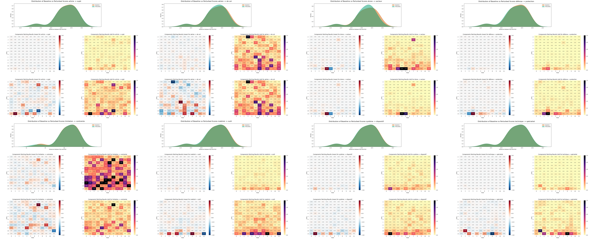
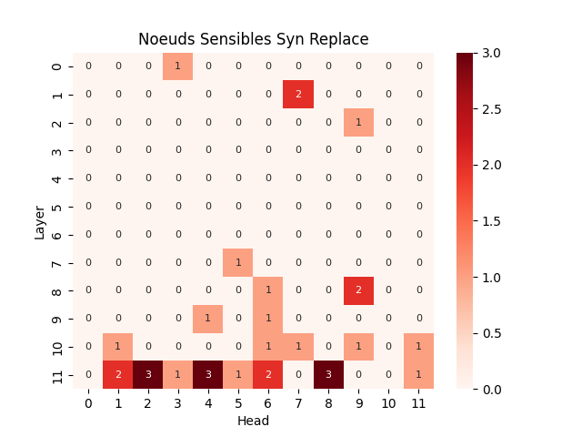
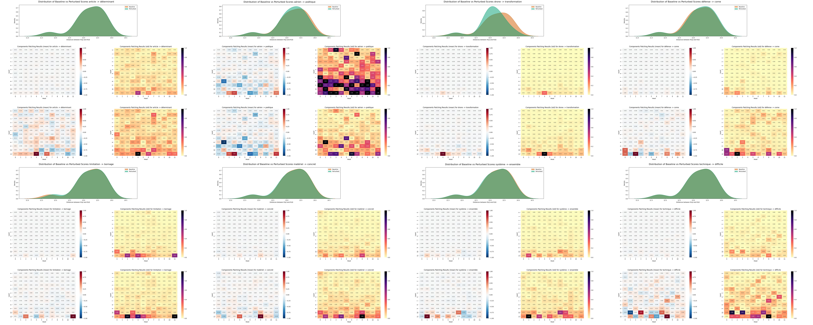
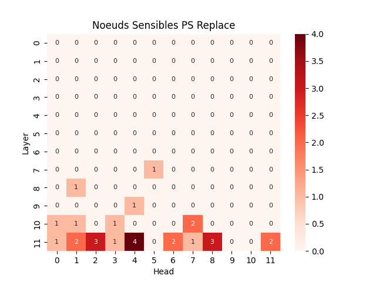
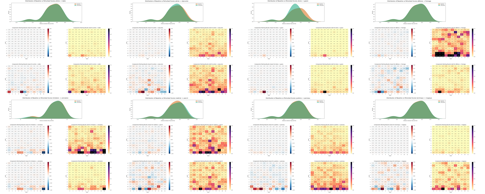
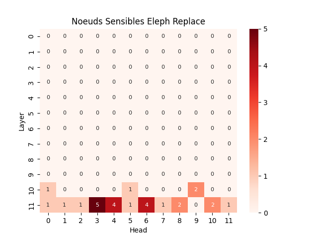
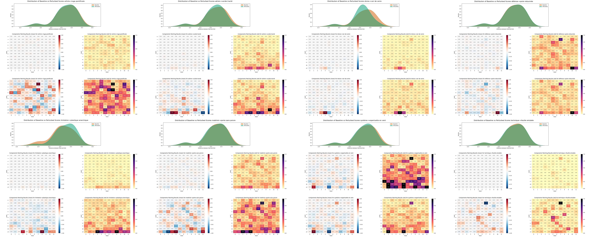
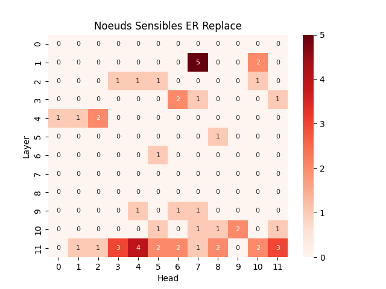
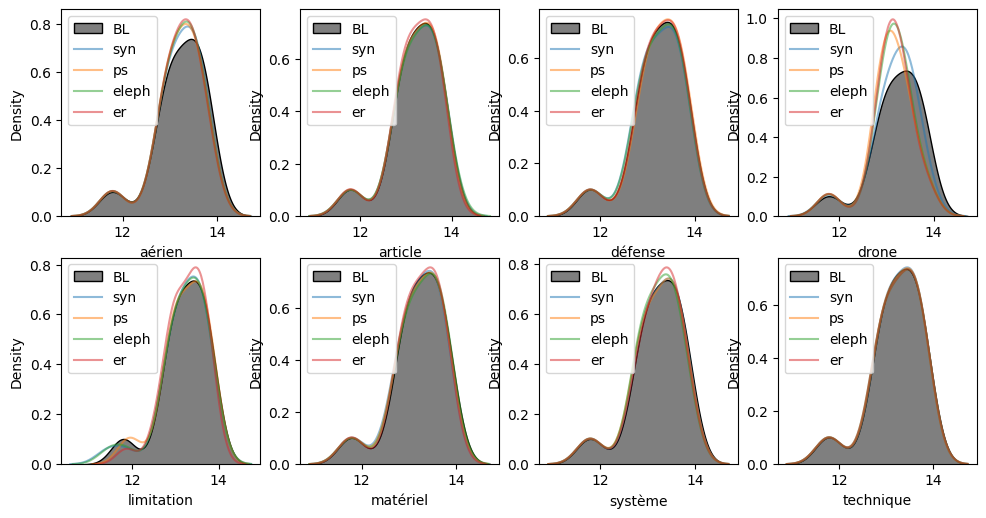
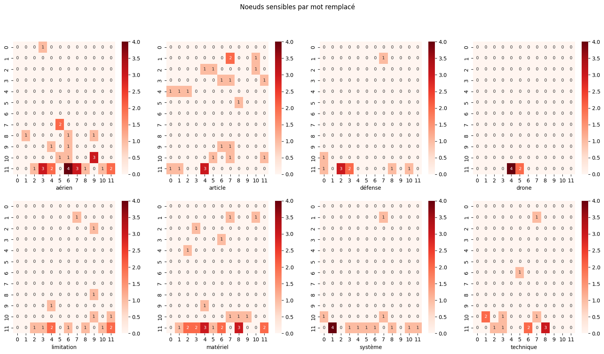

# Contexte
début : 19 juin  
Objectif : mettre en perspectives les résultats des dernières expériences

# Dataset défense fait main V2 

Construction des données :

- 1 question, 3 pdf (limitations matérielles du drone, code de la défense - matériel de guerre, fausses infos pdt les JO/JP)
- 50% de textes pertinents
- 28 paires

Question : 

> Quelles sont les trois principales catégories de limitations techniques affectant les systèmes de drones, et comment chacune influence-t-elle l'efficacité opérationnelle de ces vecteurs ?


|word      | freq | TF-IDF |
|----------|---|------------------|
|**matériel**  |16 |0.0627430130086598|
|**système**   |11 |0.0542242908052481|
|**limitation**|6  |0.0495565089630139|
|**drone**     |10 |0.0441649020535004|
|**défense**   |10 |0.0440955901918619|
|prendre   |6  |0.0425658179515979|
|compte    |5  |0.0404563824330286|
|action    |8  |0.0401684995180441|
|**article**   |9  |0.0400092952253956|
|ministre  |8  |0.03913497111578  |
|**aérien**    |7  |0.0366033210120314|
|acteur    |6  |0.0337084867312698|
|guerre    |8  |0.0336043799517422|


# Perturbations
On considère 4 familles de perturbations de type `replace`:

- remplacement par un synonyme ou mot proche [Niveau 1]
- remplacement par un mot synonyme d'un autre sens du mot [Niveau 2]
- remplacement par un mot qui n'est pas en lien avec le contexte [Niveau 3]
- remplacement par un groupe nominal absurde et qui n'est pas en lien avec le contexte [Niveau 4]

On applique les perturbations à des mots 

- de la langue de spécialité du dataset (la défense)
- prévalents dans le dataset
- éventuellement présents et importants pour le sens de la question du dataset

Perturbations choisies pour chaque niveau :

| Mot remplacé  | Niveau 1           | Niveau 2              | Niveau 3      | Niveau 4                 |
|:--------------|:-------------------|:----------------------|:--------------|:-------------------------|
| aérien        | de vol             | poétique              | épicurien     | acide tracté             |
| article       | sujet              | déterminant           | table         | luge pontificale         |
| défense       | protection         | corne                 | fromage       | poire retournée          |
| drone         | vecteur            | transformation        | gazon         | ver de verre             |
| limitation    | contrainte         | bornage               | animation     | plastique anarchique     |
| matériel      | outil              | concret               | post-it       | porte sans poivre        |
| système       | dispositif         | ensemble              | panneau       | esperluette en vent      |
| technique     | spécialisé         | difficile             | magique       | feuille entubée          |

# Résultats

Un noeud est considéré comme réactif si il vérifie `(mean > 0.1 et rescaled_mean > 0.5) ou rescaled_std > 0.5`.

## Synonymes [Niveau 1]
**Gestion des NaN** Le calcul des matrices de sensibilité engendre des NaN pour toute les perturbations. En moyenne, 3402 NaN on étés remplacés par 0 (effectifs allant de 3024 à 3888). Cela n'est pas surprenant étant donné le faible impact des perturbations sur la représentation des documents. La présence de NaN pour les perturbations de type `replace` est courante.

**Perturbation de l'espace de représentation** À l'exception de la transformation `drone -> vecteur`, les perturbations de niveau 1 ont très peu d'impact sur la représentation des documents. Cela est attendu car les perturbations conservent le sens des documents.

**Sensibilité des composants du modèle** Toutefois, certains noeuds du modèle réagissent aux modifications des documents parfois de façon assez faible (moyenne de perturbation du noeuds entre 0.1 et 0.3) et dans d'autres cas de façon plus importante (autour de 0.4 ou 0.5 et jusqu'à 1). Ces réactions restent très mesurées et sont systématiquement accompagnées d'un écart-type non négligeable (jusqu'à près de 3). Ces moyennes et écart-types restent très raisonnables dans la majorité des cas.



**Noeuds les plus sensibles** Certains composants du modèle réagissent à plusieurs perturbations. Toutefois, aucun noeud ne réagis à la moitié des perturbations ou plus. Les trois noeuds les plus réactifs ((11,2), (11,4), (11,8)) sont sensibles à trois perturbations chacun. Ce ne sont pas les mêmes. Ces trois noeuds appartiennent à la dernière couche du modèle (celle qui est en sortie du modèle).

{ width=300px }

Nombre de noeuds réactifs pour chaque perturbation : 
``` 
aérien -> de vol : 9
limitation -> contrainte : 5
matériel -> outil : 5
article -> sujet : 4
technique -> spécialisé : 3
défense -> protection : 2
drone -> vecteur : 2
système -> dispositif : 1
```

Noeuds sensibles et valeurs relevées pour chaque perturbation (sous la forme _(i,j) mean, std | rescaled_mean, rescaled_std_):
```
aérien -> de vol : 
	(0, 3) -0.16, 0.95 | -0.98, 1.00
	(7, 5) 0.17, 0.76 | 1.00, 0.80
	(8, 6) 0.08, 0.66 | 0.49, 0.70
	(8, 9) 0.11, 0.59 | 0.63, 0.62
	(9, 6) 0.10, 0.50 | 0.59, 0.53
	(10, 6) 0.09, 0.53 | 0.55, 0.56
	(10, 9) 0.07, 0.69 | 0.43, 0.73
	(11, 6) 0.12, 0.73 | 0.74, 0.77
	(11, 8) 0.14, 0.56 | 0.85, 0.59
limitation -> contrainte : 
	(1, 7) 0.44, 3.42 | 1.00, 1.00
	(2, 9) 0.24, 0.96 | 0.55, 0.28
	(8, 9) 0.30, 2.03 | 0.69, 0.59
	(9, 4) 0.31, 2.51 | 0.71, 0.73
	(10, 11) -0.31, 1.89 | -0.71, 0.55
matériel -> outil : 
	(11, 2) 0.07, 0.18 | 0.74, 0.74
	(11, 4) 0.08, 0.19 | 0.83, 0.80
	(11, 6) 0.01, 0.15 | 0.15, 0.62
	(11, 8) 0.10, 0.24 | 1.00, 1.00
	(11, 11) -0.09, 0.21 | -0.91, 0.88
article -> sujet : 
	(1, 7) 0.04, 0.12 | 0.61, 0.61
	(10, 7) -0.06, 0.18 | -0.87, 0.88
	(11, 1) 0.06, 0.20 | 1.00, 1.00
	(11, 4) 0.04, 0.14 | 0.63, 0.68
technique -> spécialisé : 
	(10, 1) 0.04, 0.21 | 0.86, 0.86
	(11, 2) 0.03, 0.14 | 0.55, 0.55
	(11, 8) -0.05, 0.25 | -1.00, 1.00
défense -> protection : 
	(11, 2) -0.09, 0.24 | -0.63, 0.64
	(11, 3) 0.15, 0.37 | 1.00, 1.00
drone -> vecteur : 
	(11, 4) 0.95, 2.96 | 1.00, 1.00
	(11, 5) -0.64, 2.54 | -0.66, 0.86
système -> dispositif : 
	(11, 1) 0.28, 0.59 | 1.00, 1.00
``` 

## Polysémie [Niveau 2]

**Gestion des NaN** Le calcul des matrices de sensibilité a généré des NaN (en moyenne 3528 NaN par perturbation). D'une perturbation à l'autre, le nombre de NaN va de 3168 à 4032. La majorité des perturbations n'ayant que très peu d'impact sur la représentation des documents, ces ordres de grandeur ne sont pas étonnants.

**Perturbation de l'espace de représentation des documents et questions** La majorité des perturbations n'ont presque pas d'impact sur la représentation des documents. `aérien -> poétique`et `défense -> corne`ont un impact qui ne peut pas être assimilé à un artefact. Seul `drone -> transformation` provoque une forte perturbation de la représentation des documents.



**Sensibilité des composants du modèle** De façon inattendue, la perturbation avec les noeuds les plus réactifs n'est pas `drone -> transformation` qui n'a qu'un seul noeuds considéré comme sensible ((11,4) 0.17, 0.32). La perturbation à laquelle le plus de noeuds est sensible est `aérien -> poétique` avec 8 noeuds sensibles. Pour une grande partie des perturbations, très peu de noeuds sont considérés comme sensibles (entre 1 et 3 avec des moyennes inférieures à 0.2 pour ces noeuds). `aérien -> poétique`, `technique -> difficile` et `défense -> corne` se démarquent avec respectivement 8, 5 et 4 noeuds sensibles, majoritairement dans les deux couches les plus profondes du modèle (couches 10 et 11).

**Noeuds les plus sensibles** Les trois noeuds les plus souvent sensibles sont (11, 4), (11, 2) et (11, 8) avec respectivement 4,3 et 3 perturbations impactantes. (11, 4) est sensible aux perturbations qui impactent peu de noeuds. (11, 2) et (11, 8) sont sensibles à des perturbations qui impactent plus de noeuds. Encore une fois ces noeuds appartiennent tous à la dernière couche du modèle.

{ width=300px }

Nombre de noeuds relevés par perturbation:
``` 
aérien -> poétique : 8
technique -> difficile : 5
défense -> corne : 4
limitation -> bornage : 3
matériel -> concret : 3
système -> ensemble : 2
article -> déterminant : 1
drone -> transformation : 1
```

Noeuds impactés par chaque perturbation:
``` 
aérien -> poétique : 
	(7, 5) -0.40, 2.91 | -0.53, 0.74
	(8, 1) -0.75, 3.93 | -1.00, 1.00
	(9, 4) -0.52, 2.79 | -0.70, 0.71
	(11, 2) 0.47, 2.79 | 0.63, 0.71
	(11, 3) 0.67, 3.00 | 0.89, 0.76
	(11, 6) -0.58, 3.58 | -0.77, 0.91
	(11, 7) -0.40, 2.07 | -0.53, 0.53
	(11, 11) 0.54, 2.28 | 0.72, 0.58
technique -> difficile : 
	(10, 1) -0.05, 0.24 | -0.90, 0.90
	(10, 3) 0.04, 0.22 | 0.83, 0.83
	(10, 7) 0.03, 0.16 | 0.59, 0.59
	(11, 6) -0.03, 0.14 | -0.54, 0.54
	(11, 8) 0.05, 0.27 | 1.00, 1.00
défense -> corne : 
	(10, 0) 0.06, 0.15 | 0.60, 0.59
	(11, 0) 0.06, 0.14 | 0.58, 0.57
	(11, 2) 0.10, 0.24 | 1.00, 1.00
	(11, 8) 0.05, 0.12 | 0.50, 0.51
limitation -> bornage : 
	(11, 2) 0.07, 0.57 | 0.53, 0.94
	(11, 4) -0.05, 0.49 | -0.33, 0.80
	(11, 11) 0.14, 0.61 | 1.00, 1.00
matériel -> concret : 
	(11, 1) -0.06, 0.23 | -0.34, 0.53
	(11, 4) 0.11, 0.28 | 0.60, 0.64
	(11, 8) 0.18, 0.44 | 1.00, 1.00
système -> ensemble : 
	(10, 7) 0.11, 0.24 | 0.54, 0.56
	(11, 1) 0.21, 0.42 | 1.00, 1.00
article -> déterminant : 
	(11, 4) 0.08, 0.53 | 1.00, 1.00
drone -> transformation : 
	(11, 4) 0.17, 0.32 | 1.00, 1.00
```

## Éléphants [Niveau 3]
**Gestion des NaN** Le calcul des matrices implique le traitement de valeurs NaN. En moyenne, chaque perturbation a engendré 3402 NaN, tous remplacés par 0. Le nombre de NaN pour chaque perturbation va de 3024 à 3888. Ce phénomène est courant pour les transformations de type `replace`.

**Perturbation de l'espace de représentation des documents et questions** Les effets des perturbations sur la représentation des documents est assez variable. Certaines perturbations ont un impact si faible qu'il peut être considéré comme négligeable ou comme un artefact. Les perturbations `aérien -> épicurien` et `matériel -> post-it` ont un faible impact sur les représentations des documents mais il ne peut être négligé. `drone -> gazon` Impacte de façon beaucoup plus importante la représentation des documents. Elle engendre une concentration d'une partie d'entre eux autour d'une distance  à la question de 13.



**Sensibilité des composants du modèle** Comme pour la perturbation de niveau 2 associée, `drone -> gazon` n'impacte qu'un seul composant, le même et faiblement (moyenne à 0.21, écart-type de 0.38). Une grande partie des perturbations n'impactent pas ou très peu de noeuds si on se fie aux moyennes. Lorsqu'on inclue les écarts-types dans les critères d'identification, le nombre de noeuds sensible augmente (moyennes autour des +/-0.02 avec des écart-types rescalés allant de 0.5 à 1). La perturbation `technique -> magique` illustre très bien ce phénomène. De façon globale, les moyennes sont assez basses en valeur absolue (-0.32, 0.24 et 0.21 sont les trois plus élevées, toutes perturbations confondues).

**$\Rightarrow$ Le critère de sélection des noeuds _sensibles_ doit être revu**

**Noeuds les plus sensibles** Étant données les moyennes très faibles et les artefacts introduits par le critère de désignation des noeuds sensibles, la liste des noeuds sensibles est peu fiable. Malgré cela, Le noeud (11,3) semble se dégager comme _vraiment_ sensible (certaines moyennes atteignent 0.13, -0.32, -0.14). De la même façon mais moins marqué, on retrouve (11, 4) avec des moyennes à 0.21, et 0.12.

{ width=300px }

Nombre de noeuds relevés par perturbation:
``` 
aérien -> épicurien : 7
système -> panneau : 7
matériel -> post-it : 4
technique -> magique : 3
défense -> fromage : 2
article -> table : 2
drone -> gazon : 1
limitation -> animation : 1
```

Noeuds impactés par chaque perturbation:
``` 
aérien -> épicurien : 
	(10, 5) -0.06, 0.30 | -0.51, 0.63
	(10, 9) 0.07, 0.47 | 0.58, 1.00
	(11, 3) 0.07, 0.38 | 0.60, 0.82
	(11, 4) 0.12, 0.43 | 1.00, 0.93
	(11, 6) 0.03, 0.31 | 0.26, 0.66
	(11, 7) 0.05, 0.41 | 0.46, 0.88
	(11, 10) -0.05, 0.32 | -0.39, 0.69
système -> panneau : 
	(10, 0) 0.07, 0.26 | 0.56, 0.55
	(11, 1) 0.11, 0.32 | 0.79, 0.69
	(11, 3) 0.13, 0.33 | 1.00, 0.71
	(11, 4) 0.03, 0.33 | 0.22, 0.70
	(11, 6) 0.06, 0.47 | 0.45, 1.00
	(11, 8) -0.07, 0.39 | -0.51, 0.84
	(11, 10) -0.09, 0.34 | -0.71, 0.72
matériel -> post-it : 
	(10, 9) 0.21, 1.08 | 0.65, 0.71
	(11, 3) -0.32, 1.53 | -1.00, 1.00
	(11, 5) -0.17, 0.96 | -0.54, 0.63
	(11, 6) 0.27, 0.91 | 0.86, 0.60
technique -> magique : 
	(11, 3) 0.02, 0.12 | 1.00, 1.00
	(11, 6) -0.01, 0.06 | -0.53, 0.53
	(11, 8) 0.01, 0.07 | 0.58, 0.58
article -> table : 
	(11, 0) 0.05, 0.17 | 0.73, 0.75
	(11, 4) 0.07, 0.23 | 1.00, 1.00
défense -> fromage : 
	(11, 2) 0.24, 6.16 | 1.00, 1.00
	(11, 3) -0.14, 1.28 | -0.61, 0.21
drone -> gazon : 
	(11, 4) 0.21, 0.38 | 1.00, 1.00
limitation -> animation : 
	(11, 11) -1.00, 4.34 | -1.00, 1.00
```

## Éléphants Roses [Niveau 4]
**Gestion des NaN** Le calcul des matrices implique le traitement de valeurs NaN. En moyenne, chaque perturbation a engendré 3402 NaN, tous remplacés par 0. Le nombre de NaN pour chaque perturbation va de 3024 à 3888. Ce phénomène est courant pour les transformations de type `replace`.

**Perturbation de l'espace de représentation des documents et questions** On retrouve encore des perturbations avec un impact négligeable (`article -> luge pontificale`, `matériel -> porte sans poivre`, `technique -> feuille entubée`, `défense -> poire retournée` ). Les autres perturbations sont peu impactantes (`système -> esperluette en vent`, `aérien -> acide tracté`). La perturbation `drone -> ver de verre` est la plus impactante.



**Sensibilité des composants du modèle** Comme pour les perturbations précédentes, les noeuds ne sont pas très sensibles. On retrouve beaucoup de matrices avec des noeuds les plus sensibles avec une moyenne proche de 0.2. La seule perturbation qui se détache avec des noeuds les plus sensibles qui dépassent les 0.5 en valeur absolue est `système -> esperluette en vent`. Les perturbations qui n'ont pas de noeud sensible (au regard des moyennes) tendent à ne pas avoir de noeud qui se dégage lors du rescaling (trop de noeuds ressortent mais sans réelle frontière entre les plus sensibles et ceux qui le sont moins). C'est majoritairement le cas lorsque les écarts-types aussi ne montrent rien. Dans le cas où certains écarts-types sont remarquable, le rescaling des moyennes met en evidence certains noeuds. Les valeurs étant faibles, il faut tout de même être vigilant sur l'intérêt de ces noeuds

**$\Rightarrow$ Le rescaling est-il un argument suffisant pour considérer un noeuds à faible reaction (petite moyenne) sensible?**

**Noeuds les plus sensibles** Le rescaling (notamment des écarts-types lorsque toutes les valeurs sont proches de 0) force la considération de noeuds sensibles alors que leurs moyennes et écarts-types sont faibles. Dans ces situations, un très grand nombre de noeuds ressort alors qu'aucun n'est pertinent (ex: `article -> luge pontificale` présente aucun noeud pertinent mais le rescaling fait noter comme sensible 16 noeuds).

**$\Rightarrow$ Interprétation impossible de la matrices des noeuds sensibles**

{ width=300px }

Nombre de noeuds relevés par perturbation:
``` 
article->luge pontificale : 16
matériel->porte sans poivre : 13
limitation->plastique anarchique : 6
aérien->acide tracté : 6
système->esperluette en vent : 4
défense->poire retournée : 2
drone->ver de verre : 2
technique->feuille entubée : 2
```

Noeuds impactés par chaque perturbation:
``` 
article->luge pontificale : 
	(1, 7) 0.05, 0.15 | 1.00, 0.98
	(1, 10) 0.01, 0.12 | 0.13, 0.76
	(2, 4) 0.02, 0.10 | 0.47, 0.64
	(2, 5) 0.03, 0.08 | 0.49, 0.50
	(2, 10) 0.03, 0.09 | 0.54, 0.59
	(3, 6) -0.03, 0.13 | -0.59, 0.82
	(3, 7) 0.04, 0.16 | 0.82, 1.00
	(3, 11) 0.03, 0.09 | 0.52, 0.55
	(4, 0) 0.03, 0.11 | 0.62, 0.72
	(4, 1) -0.03, 0.10 | -0.54, 0.62
	(4, 2) 0.03, 0.09 | 0.54, 0.59
	(5, 8) 0.03, 0.10 | 0.58, 0.66
	(9, 6) -0.03, 0.09 | -0.54, 0.55
	(9, 7) 0.03, 0.08 | 0.51, 0.53
	(10, 5) 0.04, 0.11 | 0.69, 0.72
	(10, 11) 0.03, 0.10 | 0.66, 0.66
matériel->porte sans poivre : 
	(1, 7) 0.06, 0.37 | 0.40, 0.89
	(1, 10) -0.04, 0.26 | -0.25, 0.61
	(2, 3) -0.05, 0.21 | -0.31, 0.51
	(3, 6) -0.06, 0.31 | -0.40, 0.75
	(4, 2) 0.07, 0.22 | 0.45, 0.52
	(9, 4) -0.08, 0.21 | -0.51, 0.51
	(10, 7) 0.03, 0.22 | 0.20, 0.52
	(10, 8) 0.10, 0.25 | 0.64, 0.59
	(11, 2) -0.14, 0.40 | -0.95, 0.95
	(11, 3) 0.12, 0.29 | 0.76, 0.70
	(11, 4) 0.15, 0.42 | 1.00, 1.00
	(11, 8) -0.05, 0.25 | -0.33, 0.59
	(11, 11) 0.13, 0.32 | 0.86, 0.77
aérien->acide tracté : 
	(10, 9) 0.07, 0.52 | 0.68, 1.00
	(11, 3) 0.10, 0.39 | 1.00, 0.74
	(11, 4) 0.09, 0.45 | 0.87, 0.87
	(11, 6) 0.05, 0.45 | 0.51, 0.86
	(11, 7) 0.04, 0.37 | 0.43, 0.70
	(11, 11) -0.09, 0.37 | -0.93, 0.71
limitation->plastique anarchique : 
	(10, 9) -0.04, 0.10 | -0.52, 0.52
	(11, 3) 0.06, 0.19 | 0.80, 0.96
	(11, 4) 0.00, 0.14 | 0.06, 0.73
	(11, 6) -0.01, 0.11 | -0.12, 0.56
	(11, 8) 0.07, 0.19 | 1.00, 1.00
	(11, 10) 0.03, 0.11 | 0.44, 0.56
système->esperluette en vent : 
	(1, 7) 0.35, 1.61 | 0.43, 0.63
	(11, 1) 0.82, 2.57 | 1.00, 1.00
	(11, 5) -0.78, 2.49 | -0.95, 0.97
	(11, 11) 0.52, 1.75 | 0.63, 0.68
défense->poire retournée : 
	(1, 7) -0.13, 0.76 | -0.53, 0.57
	(11, 10) 0.25, 1.33 | 1.00, 1.00
drone->ver de verre : 
	(11, 4) 0.24, 0.44 | 1.00, 1.00
	(11, 5) -0.12, 0.24 | -0.49, 0.56
technique->feuille entubée : 
	(1, 7) -0.03, 0.15 | -1.00, 1.00
	(6, 5) 0.01, 0.08 | 0.52, 0.52
```

## Lecture transversale

**Perturbation de l'espace de représentation** L'espace de représentation est perturbé de façon similaire pour un même mot remplacé (quelque soit le mot remplaçant). De plus, la majorité des distributions des documents perturbés restent assez proche de la distribution des documents originaux.



**Gestion des NaN** Pour la plupart des mots remplacés, le nombre de NaN qui apparaît lors du calcul des matrices de sensibilité reste le même peut importe le mot par lequel il est remplacé (voir tableau après). Le seul cas qui ne vérifie pas cette situation est ce lui de _drone_. Le calcul de la matrice de sensibilité pour `drone -> transformation` génère 4032 NaN alors que pour `drone -> vecteur`, `drone -> gazon` et `drone -> ver de verre` on obtient 3024 NaN.

| Mot remplacé | Niveau 1 | Niveau 2 | Niveau 3 | Niveau 4 |
| :------------|:---------|:---------|:---------|:---------|
| aérien       | 3312     | 3312     | 3312     |  3312    |
| article      | 3600     | 3600     | 3600     | 3600     |
| défense      | 3456     | 3456     | 3456     | 3456     |
| drone        | 3024     | 4032     | 3024     | 3024     |
| limitation   | 3456     | 3456     | 3456     | 3456     |
| matériel     | 3312     | 3312     | 3312     | 3312     |
| système      | 3168     | 3168     | 3168     | 3168     |
| technique    | 3888     | 3888     | 3888     | 3888     |

**Noeuds sensibles** En visualisant les noeuds sensibles aux perturbations pour un mot remplacé, on peut dans certains cas identifier un noeud sensible à la majorité voire toutes les perturbations de ce mot. On peut aussi visualiser le bruit introduit par le critère d'identification des noeuds sensibles mentionné lors de la lecture des résultats des perturbations de niveau 4 (éléphants roses). Par ailleurs, il ne se dégage pas de noeud sensible commun à tous les mot remplacés. La tendance des noeuds sensibles à être en dernière couche reste présente.



Pour `aérien`et `article` il semble apparaître un noeud sensible qui n'est pas sur les dernières couches. Cependant, leur sensibilité ne concerne que 2 des 4 niveaux de perturbation. _Doit-on les prendre en compte?_

# Conclusion

- Revoir le critère `est_noeuds_sensible` pour mieux gérer le cas de l'écart-type rescalé. 
- Certains noeuds se dégagent clairement pour un mot remplacé:
    - `aérien` : (11,6) (Sensible pour les 4)
    - `drone` : (11,4)
    - `système` : (11,1)
    - `article` : (11,4) (Seul sensible pour 3/4)
    - `défense` : (11,2) 
    - `technique` : (11,8)
- On peut noter quelques noeuds sensibles plusieurs fois (max 5/8) pour un même niveau de perturbation
    - Niveau 3 (elephants gris) : (11,3) (Sensible pour 5/8 mots)
    - Niveau 4 (elephants roses) : (1,7) 
    - Niveau 2 (polysémie) : (11,4) (Sensible pour 4/8 mots)
    - Niveau 1 (synonymes) : (11,2), (11,4), (11,8) (Sensible pour 3/8 mots)
- Si les perturbations impactent l'espace, on a des matrices de sensibilité plus marquées. Cependant, lorsque les perturbations n'impactent pas ou peu l'espace de représentation, on peut tout de même identifier des noeuds sensibles (même si il faut être plus vigilant vis-a-vis du bruit).
