# Contexte
début : 22 juin  
Objectifs : 

- Mettre en evidence un domaine et non simplement des mots individuellement
- Réduire les effets du bruit avec des perturbations plus impactantes

# Dataset défense fait main V2 

Construction des données :

- 1 question, 3 pdf (limitations matérielles du drone, code de la défense - matériel de guerre, fausses infos pdt les JO/JP)
- 50% de textes pertinents
- 28 paires

Question : 

> Quelles sont les trois principales catégories de limitations techniques affectant les systèmes de drones, et comment chacune influence-t-elle l'efficacité opérationnelle de ces vecteurs ?


|word      | freq | TF-IDF |
|----------|---|------------------|
|**matériel**  |16 |0.0627430130086598|
|**système**   |11 |0.0542242908052481|
|**limitation**|6  |0.0495565089630139|
|**drone**     |10 |0.0441649020535004|
|**défense**   |10 |0.0440955901918619|
|prendre   |6  |0.0425658179515979|
|compte    |5  |0.0404563824330286|
|action    |8  |0.0401684995180441|
|**article**   |9  |0.0400092952253956|
|ministre  |8  |0.03913497111578  |
|**aérien**    |7  |0.0366033210120314|
|acteur    |6  |0.0337084867312698|
|guerre    |8  |0.0336043799517422|


# Perturbations

On considère 4 familles de perturbations de type `replace`:

- remplacement par un synonyme ou mot proche [Niveau 1]
- remplacement par un mot synonyme d'un autre sens du mot (exploitation de la polysémie des mots ciblés) [Niveau 2]
- remplacement par un mot qui n'est pas en lien avec le contexte [Niveau 3]
- remplacement par un groupe nominal absurde et qui n'est pas en lien avec le contexte [Niveau 4]


Choix du mot remplacé à l'aide de :

- fréquence et TF-IDF des documents
- contenu de la question

## Perturbations de Niveau 1

Perturbation 4: 
```
aérien -> de vol
article -> sujet
défense -> protection
drone -> engin autonome
limitation -> contrainte
matériel -> outil
système -> dispositif
technique -> spécialisé
``` 


## Perturbations de Niveau 2

Perturbation 1:
``` 
aérien -> poétique
technique -> difficile
défense -> corne
limitation -> bornage
matériel -> concret
système -> ensemble 
article -> déterminant
drone -> transformation 
``` 

Perturbation 2:
``` 
aérien -> vaporeux
technique -> procédé
défense -> justification
limitation -> démarcation
matériel -> outil
système -> doctrine
article -> achat
drone -> abeille
``` 

Perturbation 3:
``` 
aérien -> diaphane
technique -> fin
défense -> sport de combat
limitation -> régulation
matériel -> palpable
système -> institution
article -> publication
drone -> bourdon
```

## Perturbations de Niveau 3

Perturbation 5:
```
aérien -> épicurien
article -> table
défense -> fromage
drone -> gazon
limitation -> animation
matériel -> post-it
système -> panneau
technique -> magique
```


## Perturbations de Niveau 4

Perturbation 6:
```
aérien -> acide tracté
article -> luge pontificale
défense -> poire retournée
drone -> ver de verre
limitation -> plastique anarchique
matériel -> porte sans poivre
système -> esperluette en vent
technique -> feuille entubée

```


# Résultats
Les critère de sensibilité d'un noeuds utilisé dans la suite est _(|mean|>0.1 et |resc_mean| > 0.5) ou (std>0.1 et resc_std>0.5)_

## Perturbations de Niveau 1
**Gestion des NaN** La perturbation 4 génère 1872 NaN lors du calcul des matrices de sensibilité

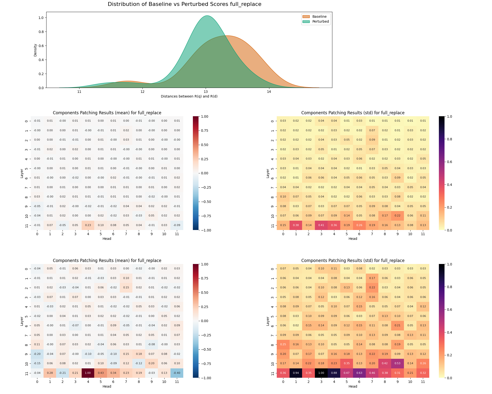

**Perturbation de l'espace de représentation** La perturbation 4 provoque un resserment des extraits à une distance de 13 autour de la question. Le groupe de documents à une distance d'environ 11,75 de la question est plus étalé. 

**Sensibilité du modèle** La perturbation des données impacte très peu de noeuds et de façon très faible. 

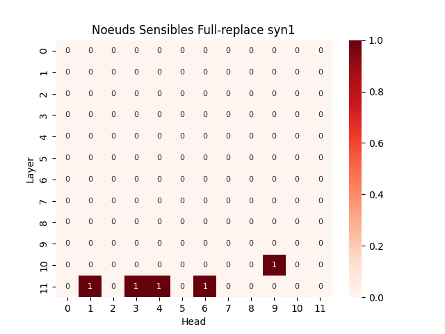{width=300px}

**Noeuds sensibles** Comme dans d'autres expériences, le noeuds (11,4) est très sensible à la perturbation 4. Quatre autres noeuds sont identifiés comme sensible. Ce sont des noeuds qui reviennent couramment ((11, 1), (11, 3), (11, 6)) pour la plupart. Ils sont tous de la 11e couche sauf le noeuds (10,9) (sélectionné pour son écart-type et non sa moyenne). Ce n'est pas le seul noeuds sélectionné pour un fort écart-type : c'est aussi le cas de (11,1) et (11,3).


``` 
Nombre de noeuds relevés : 5
```
``` 
Statistiques des noeuds sensibles:
    (10, 9) 0.05, 0.22 | 0.20, 0.53
    (11, 1) 0.07, 0.38 | 0.28, 0.94
    (11, 3) 0.05, 0.41 | 0.21, 1.00
    (11, 4) 0.23, 0.36 | 1.00, 0.88
    (11, 6) 0.08, 0.26 | 0.34, 0.63
```

## Perturbations de Niveau 2
**Gestion des NaN** Les trois perturbations génèrent le même nombre de NaN : 1872

**Perturbation de la représentation des documents** Les trois perturbations ont un impact moyen sur la représentation des documents dans l'espace latent. Les trois perturbations sont différentes.


**Noeuds sensibles** Les trois perturbations explorées ont un impact sur des composants du modèle. Les moyennes de sensibilité les plus élevées vont de 0.43 à 0.18 en valeur absolue (ordre de grandeur satisfaisant). Pour chaque perturbation, autour de 5 noeuds se détachent à première vue. La troisième perturbation semble avoir moins de noeuds sensibles, chose confirmée par les écarts-types.  
À partir des indicatrices de noeuds sensibles selon le critère `(mean > 0.1 et rescaled_mean > 0.5) ou rescaled_std > 0.5`. Seul un noeud sensible est commun aux trois perturbations explorées : (11,4). Les noeuds sensibles sont majoritairement dans la couche 11. Les deux autres sont de la couche 10.


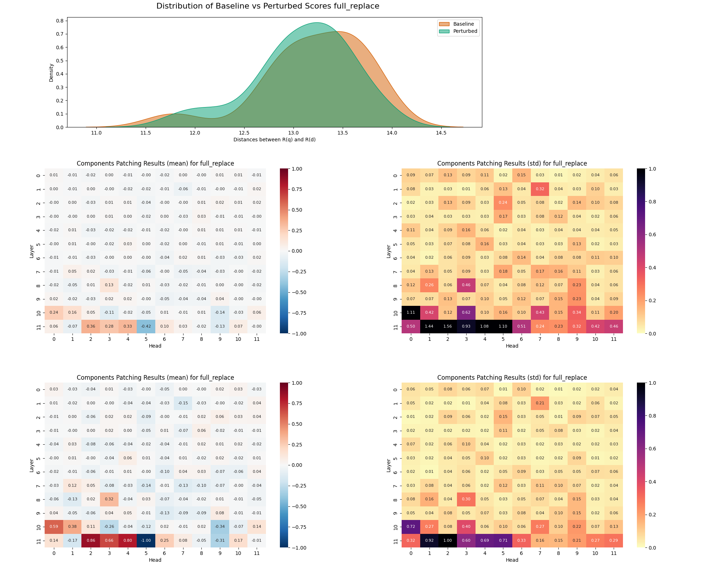

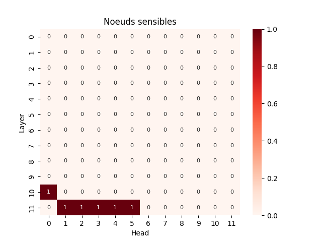{width=300px}


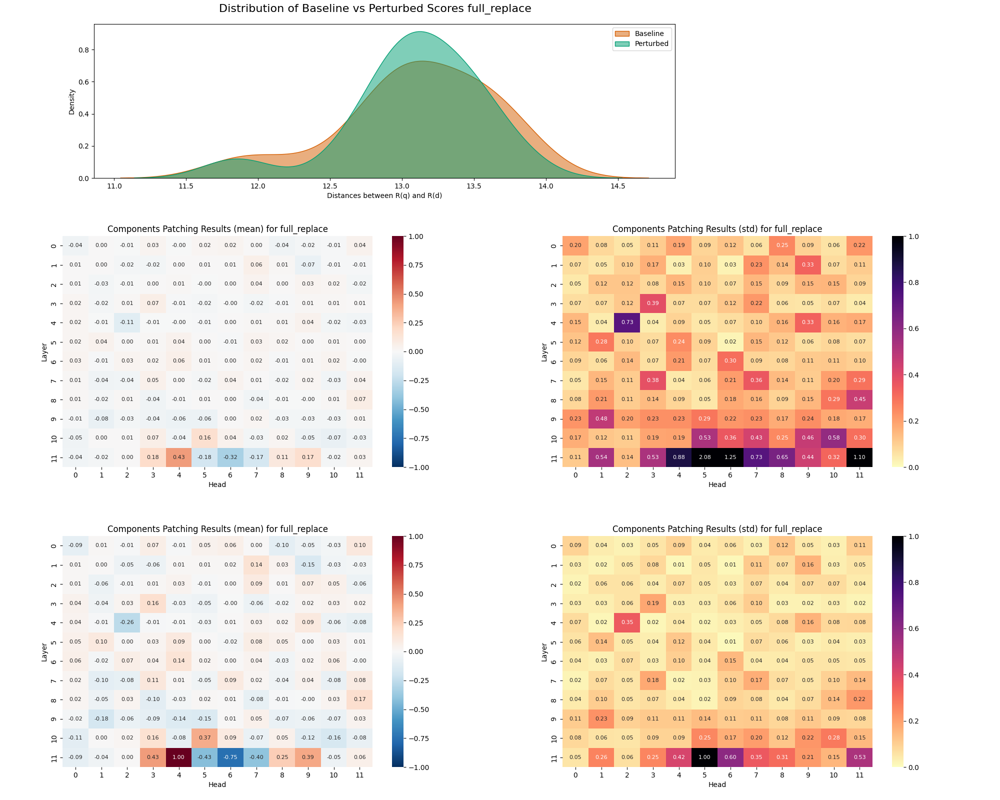

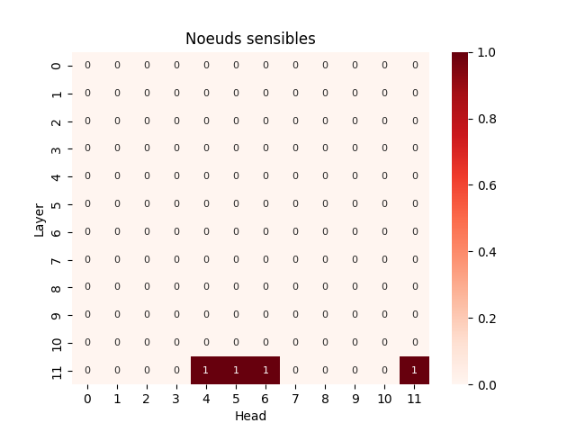{width=300px}


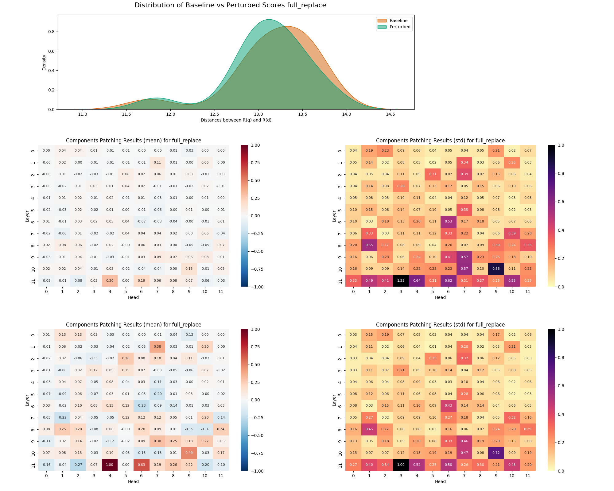

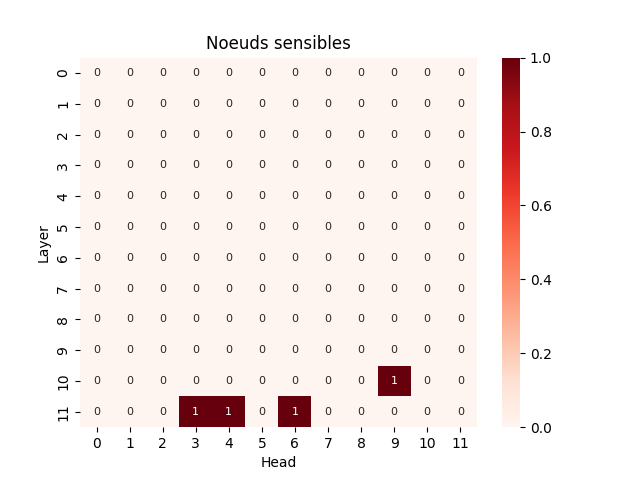{width=300px}


## Perturbation de Niveau 3
**Gestion des NaN** La perturbation 5 génère 1872 NaN lors du calcul des matrices de sensibilité.


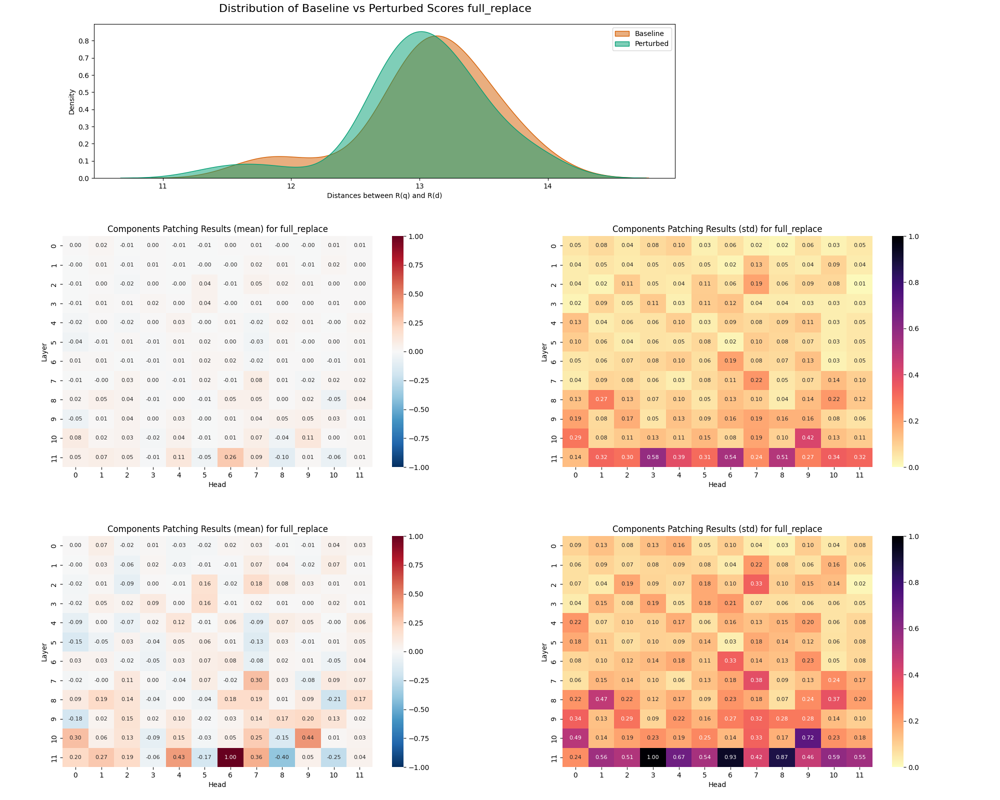

**Perturbation de la représentation des documents** La perturbation des documents engendre un rapprochement de leur représentation vers la représentation de la question.

**Sensibilité du modèle** La perturbation 5 ne semble pas impacter les composants du modèle. Les moyennes de noeuds les plus haute sont très faibles (3 noeuds entre 0.26 et 0.10 en valeur absolue pour les moyennes). Ce sont les seuls avec un écart-type significatif. 

**$\Rightarrow$ Vigilance sur l'intérêt de considérer ces noeuds**


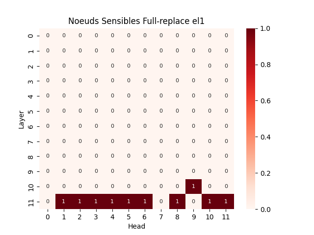{width=300px}

**Noeuds sensibles** Les écart-types des noeuds de la 11e couche sont proches de la limite de critère de selection. Le noeuds (10,9) est considéré comme sensible pour la perturbation 5 (déjà sensible à la perturbation 4).

## Perturbation de Niveau 4
**Gestion des NaN** Le calcul de la matrice de sensibilité du modèle à la perturbation 6 génère 1872 NaN.

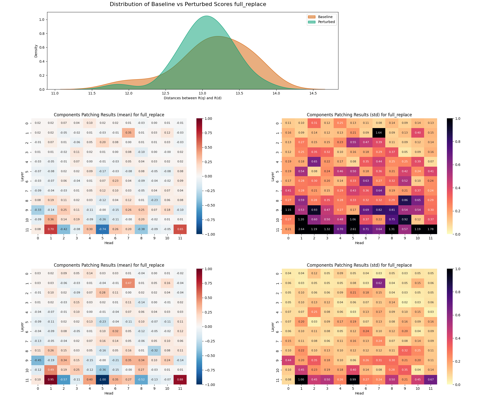

**Perturbation de la représentation des documents** Les documents sont re-sérrés autour de 13. Le pic à 11.8 est réduit par la perturbation.

**Sensibilité du modèle** Les composants du modèle sont plus sensibles à la perturbation 6 que la perturbation 5. Un bon nombre de noeuds ont des moyennes supérieures à 0.2. Certains écarts-types sont assez élevés aussi.

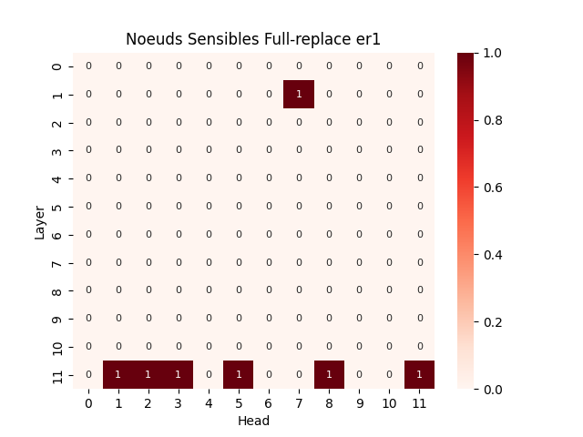{width=300px}

**Noeuds sensibles** Sur la base du critère de selection cité en début de chapitre, la moitié des noeuds de la dernière couche sont considérés comme sensibles ((11, 1), (11,2), (11,3), (11,5), (11,8), (11,11)). Le seul noeud sensible qui n'est pas de la couche 11 est (1,7). Ce noeuds  déjà été aperçu dans d'autres expériences.

## Aperçu global entre niveaux

**Gestion des NaN** Toutes les perturbations explorées génèrent le même nombre de NaN. Ce n'est pas étonnant car elles appliquent un remplacement sur le même ensemble de noeuds.

**Perturbation de la représentation des documents** On observe systématiquement un resserrement ou une légère translation de la distribution des représentations des documents.

**Sensibilité du modèle** D'un niveau à l'autre, on observe la même tendance : la majorité des noeuds sensibles sont en fin de modèle (couches 10 et 11). Le nombre de noeuds pouvant être sensible reste assez variable d'un niveau à l'autre. Le Niveau 3 est le niveau avec le moins de sensibilité du modèle pour les perturbations testées.

**Noeuds sensibles** Au sein des trois perturbations de niveau 2, le seul noeuds sensible commun au trois est (11,4). Les noeuds (11,3), (11,5) et (11,6) sont sensible à deux des trois perturbations.  
En cumulant les 6 perturbations observées, Aucun noeud sensible n'est commun à toutes les perturbations. Les noeuds (11,3) et (11,4) sont les deux seuls à être sensible à 5 perturbations. On retrouve un tendance (sous la forme d'un gaussienne) pour l'intervalle de noeuds (11,1)-(11,6). Le noeuds (11,9) est sensible à 3 des perturbations étudiées.

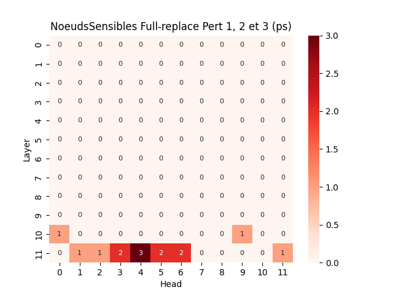{width=300px}

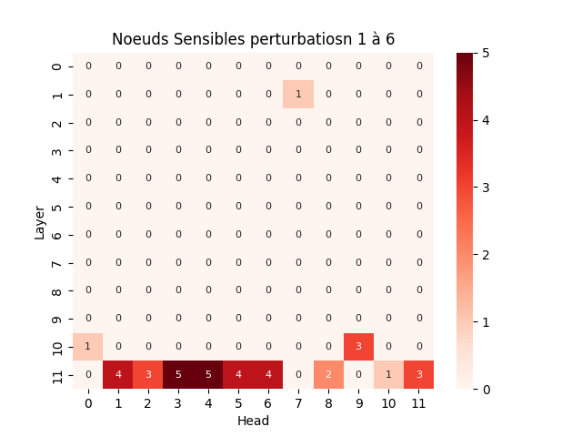{width=300px}


# Analyse
- Les noeuds sensibles sont majoritairement dans la dernière couche du modèle.
- Identification de noeuds
  - On retrouve un tendance sous la forme d'une gaussienne centrée entre les noeuds (11,3) et (11,4) sur la couche 11. Ce résultat est à prendre avec des pincettes étant donné que la couche 11 est la plus proche des embeddings finaux.
  - Le noeud (10,9) pourrai être un noeud remarquable qui n'appartient pas à la dernière couche du modèle
- La perturbation elephant est très bruitée/ impacte très peu le modèle