# Contexte
début : 1 juillet

Objectifs:

- Avoir une base de comparaison pour l'expérience de contrôle de l'importance des noeuds identifiés.
- Identifier une potentielle différence de sensibilité du modèle entre les paires positives et négatives

# Dataset défense fait main V2 

Construction des données :

- 1 question, 3 pdf (limitations matérielles du drone, code de la défense - matériel de guerre, fausses infos pdt les JO/JP)
- 50% de textes pertinents
- 28 paires

Question : 

> Quelles sont les trois principales catégories de limitations techniques affectant les systèmes de drones, et comment chacune influence-t-elle l'efficacité opérationnelle de ces vecteurs ?

|word      | freq | TF-IDF |
|----------|---|------------------|
|**matériel**  |16 |0.0627430130086598|
|**système**   |11 |0.0542242908052481|
|**limitation**|6  |0.0495565089630139|
|**drone**     |10 |0.0441649020535004|
|**défense**   |10 |0.0440955901918619|
|prendre   |6  |0.0425658179515979|
|compte    |5  |0.0404563824330286|
|action    |8  |0.0401684995180441|
|**article**   |9  |0.0400092952253956|
|ministre  |8  |0.03913497111578  |
|**aérien**    |7  |0.0366033210120314|
|acteur    |6  |0.0337084867312698|
|guerre    |8  |0.0336043799517422|

# Perturbations

On considère 4 familles de perturbations de type `replace`:

- remplacement par un synonyme ou mot proche [Niveau 1]
- remplacement par un mot synonyme d'un autre sens du mot (exploitation de la polysémie des mots ciblés) [Niveau 2]
- remplacement par un mot qui n'est pas en lien avec le contexte [Niveau 3]
- remplacement par un groupe nominal absurde et qui n'est pas en lien avec le contexte [Niveau 4]

On étend ces niveaux aux perturbations de type `full_replace` où tous les remplacements sont effectués en une même perturbation.

Choix du mot remplacé à l'aide de :

- fréquence et TF-IDF des mots dans les documents
- contenu de la question

Remplacements choisis :

| Mot remplacé  | Niveau 1           | Niveau 2              | Niveau 3      | Niveau 4                 |
|:--------------|:-------------------|:----------------------|:--------------|:-------------------------|
| aérien        | de vol             | poétique              | épicurien     | acide tracté             |
| article       | sujet              | déterminant           | table         | luge pontificale         |
| défense       | protection         | corne                 | fromage       | poire retournée          |
| drone         | vecteur            | transformation        | gazon         | ver de verre             |
| limitation    | contrainte         | bornage               | animation     | plastique anarchique     |
| matériel      | outil              | concret               | post-it       | porte sans poivre        |
| système       | dispositif         | ensemble              | panneau       | esperluette en vent      |
| technique     | spécialisé         | difficile             | magique       | feuille entubée          |

On obtient 5 lots de perturbations : 

- 8 perturbations `replace` de niveau 1
- 8 perturbations `replace` de niveau 2
- 8 perturbations `replace` de niveau 3
- 8 perturbations `replace` de niveau 4
- 4 perturbations `full_replace` (une de chaque niveau, composée des 8 perturbations précédentes)

# Résultats

Le critère de sensibilité choisi est _(|mean|>0.1 et |resc_mean| > 0.5) ou (std>0.1 et resc_std>0.5)_ .

Chaque perturbation est observée 

- Sur les paires positives (sous-dataset positif)
- Sur les paires négatives (sous-dataset négatif)
- Sur l'ensemble du dataset (données issues des expériences 5 et 6)

## Commentaire sur la distinction paires positives et paires négatives

**Distribution des paires dans l'espace de représentation** 
On observe bien des distributions des scores des paires différentes pour les paires positives et négatives. Les paires positives ont tendance à avoir des scores plus faibles que les paires négatives; ce qui est attendu. On observe aussi que la petite concentration de documents à hauteur de 11.75 est composée de documents positifs mais que tous n'y sont pas. Cela pourrait être lié à la méthode de classification que j'ai utilisée (très/trop gros grain). Certains documents mériteraient peut-être d'être classés négatifs...

## Perturbations de Niveau 1

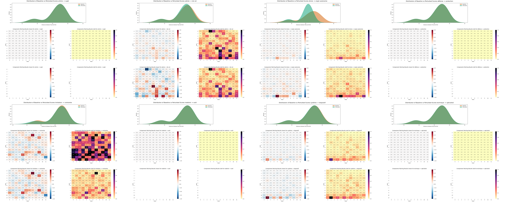

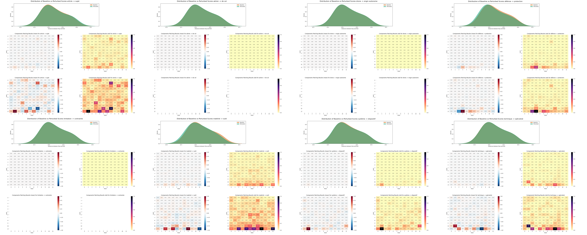

**Perturbation des représentations des documents** Selon le mot remplacé, les représentations perturbées sont soit celles de paires positives soit de paires négatives. Si le mot remplacé est présent seulement dans des paires positives, seuls certains documents issus du dossier sur les limitations matérielles des drones (documents considérés comme positifs) auront une représentation perturbée. Les documents issus des deux autres pdf (considérés comme négatifs) ne sont pas modifiés par la perturbation. Par conséquent, leur représentation reste identique. Dans ces cas, la distribution des scores (distances entre représentation de la question et celle du document) ne change pas.

**Gestion des NaN** On retrouve un nombre de NaN généré différent lorsqu'on applique la perturbation sur les paires positives et négatives. La somme du nombre de NaN pour les données positives et négatives correspond bien au nombre de Nan générés pour le dataset entier.

| Mot remplacé | Données positives | Données négatives | Dataset entier |
|:------------:|:-----------------:|:-----------------:|:--------------:|
| aérien       | 1296              | 2016              | 3312           |
| article      | 2016              | 1584              | 3600           |
| défense      | 2016              | 1440              | 3456           |
| drone        | 1008              | 2016              | 3024           |
| limitation   | 1440              | 2016              | 3456           |
| matériel     | 2016              | 1296              | 3312           |
| système      | 1296              | 1872              | 3168           |
| technique    | 2016              | 1872              | 3888           |

Dans le cas de cette expé, 2016 correspond au nombre de valeur calculées pour un sous-dataset (positif ou négatif) (14 docs x 12x12 noeuds). Les perturbations ayant généré 2016 NaN correspondent à celles qui ne modifient aucun document du sous-dataset. On peut étendre ce raisonnement aux autres valeurs. Si une perturbation ne modifie que 5 documents sur les 14 documents positifs, alors les 9 autres documents ont leur version baseline et perturbée identiques. Les représentations sont les mêmes. Lorsqu'on applique l'activation patching, le calcul effectue des divisions de 0 par 0 ce qui crée 144 NaN par document (12x12 noeuds). Si 9 documents ne sont pas modifiés par la perturbation, on obtient un total de 1296 NaN (comme pour aérien -> de vol sur les documents positifs par exemple).

$\Rightarrow$ Les NaN ne sont pas issus de valeurs devenues trop faibles mais sont dûs aux documents _insensibles_ à la perturbation effectuée.

 
**Documents modifiés par les perturbations**
Les effectifs de documents sensibles à une perturbation répartis par sous-dataset:

| Mot remplacé | Données positives | Données négatives | Dataset entier |
|:------------:|:-----------------:|:-----------------:|:--------------:|
| aérien       | 5                 | 0                 | 5              |
| article      | 0                 | 3                 | 3              |
| défense      | 0                 | 4                 | 4              |
| drone        | 7                 | 0                 | 7              |
| limitation   | 4                 | 0                 | 4              |
| matériel     | 0                 | 5                 | 5              |
| système      | 5                 | 1                 | 6              |
| technique    | 0                 | 1                 | 1              |

Pour rappel, on dispose de 14 paires positives et 14 paires négatives soit un total de 28 paires

Seul le remplacement de système impacte des documents positifs et négatifs. 

15 des 27 documents sont modifiés par au moins une des perturbations (10 documents positifs et 5 documents négatifs).

**Sensibilité du modèle aux perturbations** Les perturbations qui ne modifient aucun documents dans un des sous-datasets ne peuvent montrer aucune sensibilité du modèle à la perturbation. On obtient dans ces cas là une insensibilité du modèle (matrices avec seulement des 0). La matrice rescalée obtenue pour tout le dataset correspond alors exactement à la matrice rescalée du sous-dataset qui contient les documents modifiés par la perturbation. Ce comportement est observé pour toutes les perturbations sauf celles qui remplacent _système_. C'est la seule qui impacte des documents positifs et négatifs. Les noeuds qui semblent les plus sensibles pour cette perturbation sont les mêmes pour les documents positifs et négatifs.

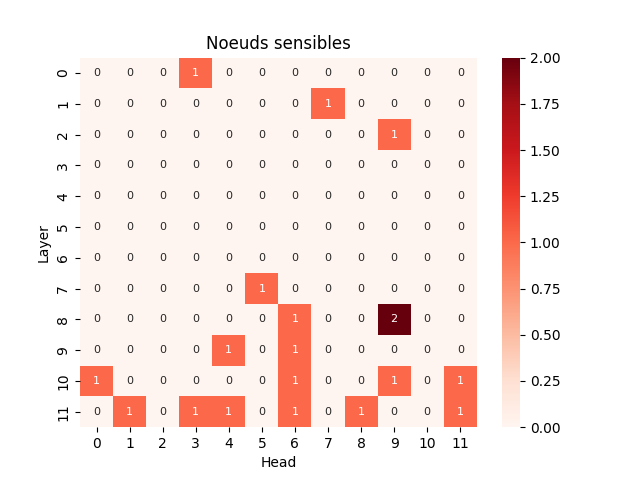{width=300px}

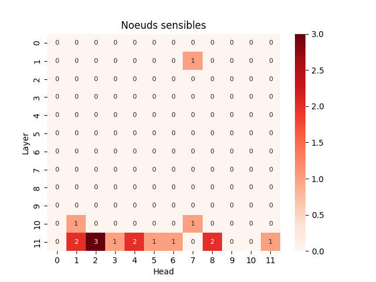{width=300px}

**Noeuds sensibles** Séparer les paires positives des paires négatives modifie la sensibilité des noeuds obtenue par l'activation patching. Ainsi des noeuds qui n'étaient pas considérés comme sensibles peuvent le devenir. Le cumul des matrices des noeuds sensibles pour les deux sous-datasets  reste pour autant assez similaire à celle globale. On observe que les noeuds les plus sensibles qui sont concentrés sur la dernière couche du modèle sont issus des deux sous-dataset mais que les noeuds sensibles des autres couches sont majoritairement issus des documents positifs. Il faut tout de même noter que les noeuds sensibles qui ne sont pas de la dernière couche appariassent pour une (éventuellement deux) perturbations. Il faut envisager que ce soit du bruit !

## Perturbations de Niveau 2

**Perturbation de la représentation des documents** Les documents et les mots remplacés étant les mêmes, on retrouve le même type de comportement des distributions des documents _perturbés_. Les documents qui ne sont pas modifiés par les perturbations conservent le même représentation et si ils sont en datasets entiers, la distribution est strictement identique. Dans ce cas, la différence de distribution observée pour le dataset complet (dans l'expérience 5) est entièrement supportée par le sous dataset complémentaire. Étant donné que peu de documents sont perturbés, les distributions des représentations sont peu modifiées (comme pour toutes les expériences précédentes). 

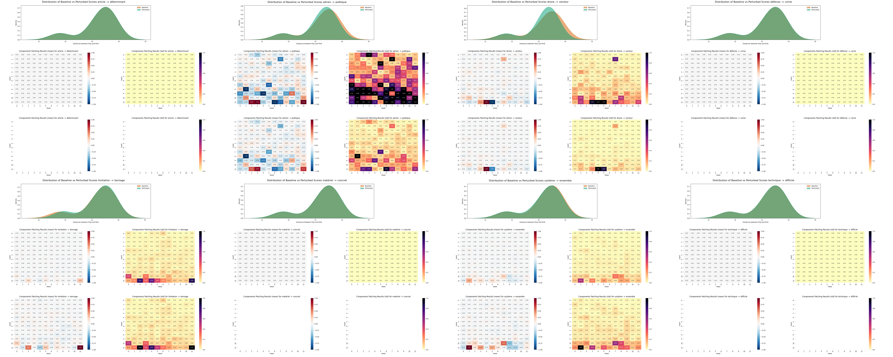

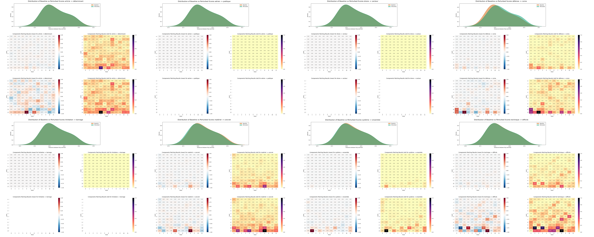

**Gestion des NaN** Les mots remplacés et les documents étant les mêmes que pour les perturbations de Niveau 1, on observe exactement le même nombre de NaN générés pour chaque (sous-)dataset et mot remplacé. 

**Sensibilité du modèle aux perturbations** Comme pour le lot de perturbations précédentes, toutes les perturbations ont un effet concentré sur le sous-dataset contenant les documents modifiés/modifiables par la perturbation. on retrouve les mêmes matrices rescalées pour le sous-dataset _sensible_ et le dataset complet.  
La seule perturbation qui modifie des documents dans les deux sous-dataset est `système -> ensemble`. Le modèle y est très peu sensible lorsqu'on observe le dataset des paires négatives (un seul noeud ressort car il a un écart-type de 0.18 > 0.1). Les observations de cette perturbation sur le dataset positif sont plus marquées : 5 noeuds semblent ressortir.

**Sensibilité des noeuds** La carte des noeuds sensibles selon le critère _(|mean|>0.1 et |resc_mean| > 0.5) ou (std>0.1 et resc_std>0.5)_ pour le sous-dataset des paires négatives met en évidence des noeuds de la dernière couche du modèle. On retrouve la même tendance pour le sous-dataset des paires positives mais quelques noeuds appartenant aux couches centrales ressortent aussi. Ces noeuds ne sont sensibles que pour une perturbation (mais avec des moyennes assez élevées par rapport aux données habituelles) : `aérien -> poétique`

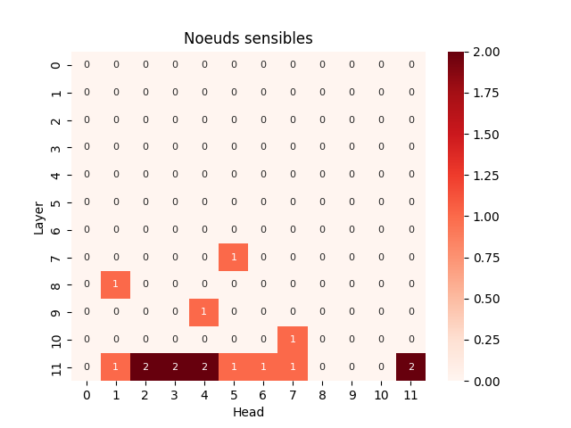{width=300px}

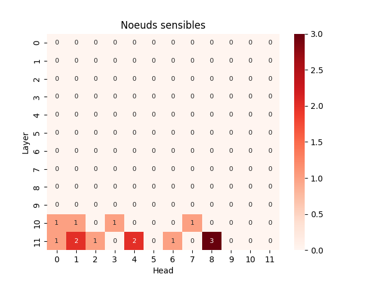{width=300px}

## Perturbation de Niveau 3 et Niveau 4

On retrouve les mêmes tendances et comportements sur ces deux autres groupes de perturbation:

- Les mêmes perturbations ont un impact que sur un sous-dataset ce qui engendre un certain nombre de distributions des représentations identiques entre baseline et perturbed documents et des matrices vides
- Le nombre de NaN des deux sous-datasets 
  - se somme au nombre NaN du dataset complet pour chaque perturbation
  - Le nombre de NaN pour chaque dataset et perturbation est divisible par le nombre de documents qui ne sont pas modifiés par la perturbation
- Les matrices de sensibilité rescalées pour les sous-datasets qui contiennent les documents modifiables par les perturbations correspondent aux matrices rescalées pour le dataset complet
- Seul `système -> ...` montre des noeuds sensibles pour les deux sous-datasets avec des noeuds plus prononcés pour le sous-dataset positifs (qui contient 5/6 ème des documents perturbables)
- Les noeuds sensibles au plus grand nombre de perturbations sont dans les deux dernières couches du modèle et sont les seuls à apparaître pour le sous-dataset des paires négatives. Les noeuds des couches intermédiaires (qui apparaissent que sur une perturbation) ne sont révélés que par des documents positifs dans le cas des éléphants-roses (aucun noeuds en couche intermédiaire pour les perturbations de niveau 3)

## Perturbations de type full-replace

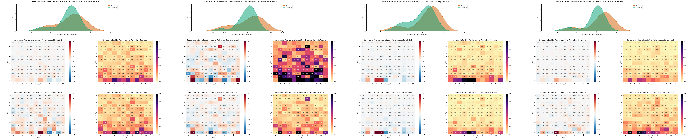

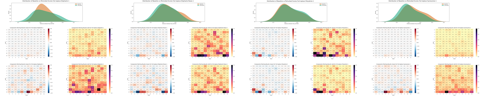

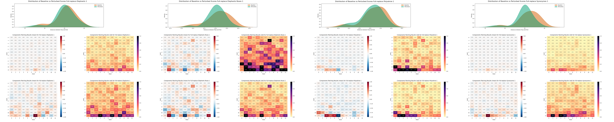

**Perturbation des représentations** Pour les perturbations full-replace de niveau 1, 2 et 4, la perturbations semble impacter plus les représentations  paires positives en concentrant les distances entre la représentation de la question et celle de la réponse autour de 13. La distribution des distances pour les documents des paires négatives est moins perturbé.  
La perturbation full-replace de niveau 3 impacte différemment la distribution des distances. On retrouve aussi une concentration des distances autour de 13 pour les documents positifs mais cela est compensé par un étalement des représentations des scores des paires négatives.  
Ce resserrement des scores des paires positives engendre une baisse de la moyenne des scores sur le sous-dataset positif et sur le dataset complet. Ce n'est pas nécessairement le comportement attendu étant donné que les perturbations en question cherchent à remplacer les informations _utiles_ par du _bruit_. Ce changement de la distribution des cores est donc difficile à interpréter.

**Gestion des NaN** Comme attendu:

- la somme du nombre de NaN généré par les datasets positifs et négatif correspond au nombre de NaN généré par les perturbations sur le dataset complet
- Le nombre de NaN obtenu correspond au nombre de documents impactés par les perturbations utilisées (10 paires positives, 5 paires négatives soit 15 paires sensibles aux perturbations)

**Sensibilité du modèle** Pour les perturbations full-replace, on ne retrouve pas la tendance précédente. Les matrices de sensibilité pour les sous-datasets positifs et négatifs sont assez similaires et très peu de noeuds des couches centrales se dégagent dans chacun de ces cas. On trouve une exception : le noeuds (1,7) pour la perturbation de niveau 4 qui apparaît pour les paires positives mais pas pour les paires négatives.

**Noeuds sensibles** D'un sous-dataset à l'autre, on retrouve la même tendance sur le nombre de noeuds sensibles : un nombre de noeuds croissant pour les niveaux 1,2 et 3 mais un chute pour le niveau 4.  
Les noeuds sensibles pour le sous-dataset positifs sont tous sensible pour le dataset complet. Ce n'est pas le cas pour le sous-dataset négatif qui met en évidence des noeuds des couches centrale (à cause de la perturbation de niveau 3) en plus des noeuds sensibles commun au dataset complet. De plus, ces noeuds communs sont détecté pour moins de perturbations.
  

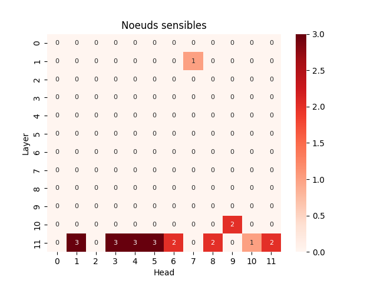{width=300px}

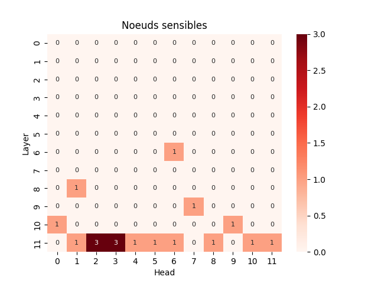{width=300px}

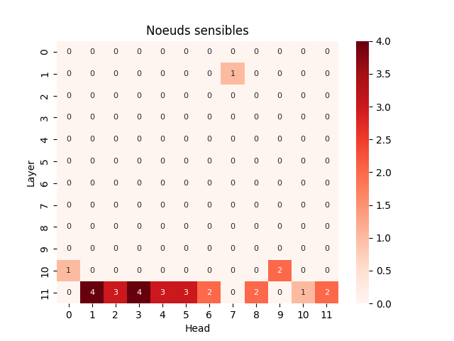{width=300px}

# Analyse

L'origine des NaN ne correspond pas à ma première piste. Ils sont issus d'une division par 0 et ne représentent pas une flottant très petit. Lorsqu'une perturbation ne modifie pas le document, pour chaque les noeuds, on obtient une score identique pour $p$, $\hat{p}$ et $\check{p}$ et donc la sensibilité provoque la division de 0 par 0. On obtient un NaN pour chaque noeuds du modèle et pour chaque document qui est _insensible_ à la perturbation. Au delà du nombre de NaN obtenu, chaque document insensible à une perturbation va diluer l'effet de la perturbation et rendre l'analyse du modèle plus difficile car les noeuds apparaîtront moins sensibles  
Cela met en lumière une faiblesse des paires (perturbations, dataset) utilisées jusqu'ici : les perturbations actuelles n'impactent que la moitié (15/26 exactement) des entrées du dataset complet (paires positives et négatives) et tendent à viser seulement les paires positives ou les paires négatives. La difficulté de construction des perturbations s'explique aussi par le faible recoupement du vocabulaire d'un document à l'autre et d'un pdf choisi à l'autre. Pour perturber un grand nombre de document à l'aide d'un seul remplacement, le mot remplacé doit apparaître un très grand nombre de fois. Cette possibilité est entravée par la méthode de construction du modèle (sélection de documents portant sur des sujets différents).

Pistes de prévention de la dilution des perturbations:
- sur les perturbations :
  - remplacements multiples (full_replace)
  - Retour aux perturbations de type append/ prepend qui modifient tous les documents
- sur le dataset
  - Restreindre le dataset aux paires sensibles à la perturbation appliquée (ie. faire du cas par cas)
  - Reconstruire un dataset avec es documents plus gros (augmente les chances d'avoir des mots communs à tous les documents)
  - Reconstruire un dataset avec moins de diversité des sujets (ie diminuer la diversité du vocabulaire)
- Sur les scores
  - exploiter le rescaling des matrices (efface l'effet de dilution)
  - adapter le critère de sensibilité pour prendre en compte le nombre de document insensible 

Par ailleurs, le manque de perturbations impactant aussi bien des paires positives que négatives ne permet pas de dégager une tendance ni d'identifier une différence de comportement/ sensibilité entre les paires positives et les paires négatives. 