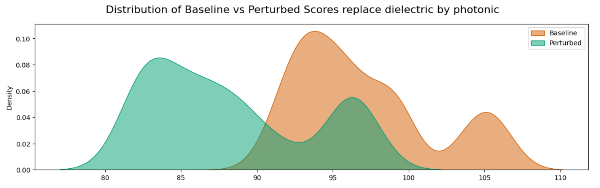
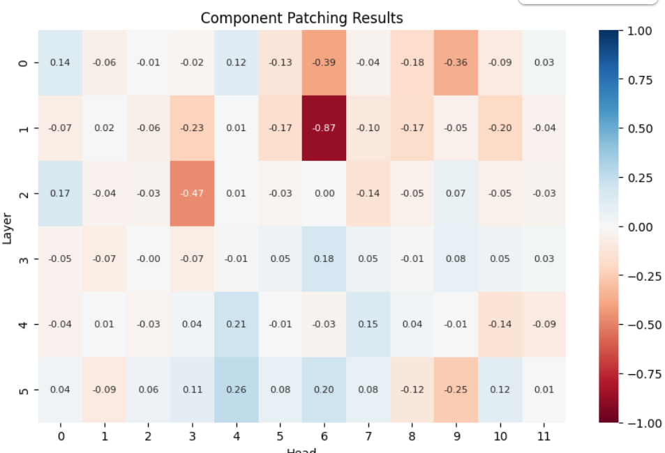

## Retrieval Augmented Generation - RAG

### Retrieval Augmented Generation - Definition

![Simple RAG Architecture [@lewis_retrieval-augmented_2020]](images/DefRAG.drawio.png)  

. . . 

![Advanced RAG Achitecture [@fan_survey_2024]](images/DefRAGAvance_integration.drawio.png)


### Example {.center}

![RAG Architecture used here (inspired from [@tran_retrieval_2024])](images/RAGHN-perso.drawio.png)

## Explainability in Artificial Intelligence

### Explainability in Artificial Intelligence

_Open black box models_

#### Aims

- Trustability
- Understandability
- Model Rectification

### Definitions

**XAI** : Make model's behavior understandable for human [@bell_its_2022]  
**Understand** : Predict model's behavior [@bell_its_2022]  
**Explanation** : Any way to make the decision process of the model understandable for human

:::: {.columns}

::: {.column width="40%"}
**Interpretability**  
_How ?_
:::

::: {.column width="40%"}

**Explanability**  
_Why ?_
:::

::::

### Explanation through creation of a model


## Presentation and Demonstration of MechIR 

### MechIR

```{python}
from mechir import Dot
from mechir.data import MechIRDataset, DotDataCollator
from mechir.perturb import perturbation
from mechir.plotting import plot_components

import torch
from torch.utils.data import DataLoader

import matplotlib.pyplot as plt
from matplotlib.ticker import MaxNLocator
import seaborn as sns

# Helper function to print query/baseline document/perturbed document triplets
def pretty_print_triplets(batch, tokenizer, num=1):
    """
    Pretty prints triplets of queries, documents, and their corresponding perturbed documents from a batch.

    Args:
        batch (dict): A dictionary containing 'queries', 'documents', and 'perturbed_documents' from a DataLoader.
        tokenizer: The tokenizer used to decode the input IDs.
        num (int): Number of examples to show per batch.
    """
    # Get the queries, documents, and perturbed documents from the batch
    queries = batch["queries"]
    documents = batch["documents"]
    perturbed_documents = batch["perturbed_documents"]

    # Loop through number of examples to show in batch
    for i in range(len(documents["input_ids"][:num])):
        # Get the input IDs
        query_ids = queries["input_ids"][i]
        original_ids = documents["input_ids"][i]
        perturbed_ids = perturbed_documents["input_ids"][i]

        # Decode the input IDs to text
        query_decoded = tokenizer.decode(query_ids.tolist(), skip_special_tokens=False).replace("[PAD]", "").strip()
        original_doc_decoded = tokenizer.decode(original_ids.tolist(), skip_special_tokens=False).replace("[PAD]", "").strip()
        perturbed_doc_decoded = tokenizer.decode(perturbed_ids.tolist(), skip_special_tokens=False).replace("[PAD]", "").strip()

        # Pretty print
        # print(f"Triplet {i + 1}:")
        print("Query:", query_decoded)
        print("Baseline Document:", original_doc_decoded)
        print("Perturbed Document:", perturbed_doc_decoded)
        print("=" * 50)  # Separator for clarity

# Helper function to calculate and store performances
def calculate_performance(model, dataloader, baseline_performance, perturbed_performance):
    for i, batch in enumerate(dataloader):
        # Get the queries, documents, and perturbed documents from the batch
        queries = batch["queries"]
        documents = batch["documents"]
        perturbed_documents = batch["perturbed_documents"]

        # Encode queries, baseline, and perturbed documents
        queries_encoded = model.forward(**queries)  # [batch_size x hidden_dim]
        baseline_encoded = model.forward(**documents)  # [batch_size x hidden_dim]
        perturbed_encoded = model.forward(**perturbed_documents)  # [batch_size x hidden_dim]

        # Calculate scores
        baseline_scores = torch.sum(queries_encoded.unsqueeze(1) * baseline_encoded.unsqueeze(0), dim=2)
        perturbed_scores = torch.sum(queries_encoded.unsqueeze(1) * perturbed_encoded.unsqueeze(0), dim=2)

        # Append flattened scores to the performance lists
        baseline_performance += baseline_scores.flatten().tolist()
        perturbed_performance += perturbed_scores.flatten().tolist()

# Helper function to plot score distributions between baseline and perturbed documents
def plot_score_dists_mult(all_baseline_scores, all_perturbed_scores, plot_type="hist"):
    # Number of subplots (one per perturbation type)
    num_plots = len(all_baseline_scores)

    # Set up the figure to hold multiple subplots in a single row
    fig, axs = plt.subplots(1, num_plots, figsize=(15, 4), sharey=True)
    fig.suptitle('Distribution of Baseline vs Perturbed Scores', fontsize=16)

    for idx, (perturb_type, ax) in enumerate(zip(all_baseline_scores.keys(), axs)):
        baseline_scores = all_baseline_scores[perturb_type]
        perturbed_scores = all_perturbed_scores[perturb_type]

        if plot_type == "hist":
            ax.hist(baseline_scores, label='Baseline', color='blue', alpha=0.5, bins=15)
            ax.hist(perturbed_scores, label='Perturbed', color='orange', alpha=0.5, bins=15)
            ax.yaxis.set_major_locator(MaxNLocator(integer=True))
            ax.set_ylabel('Frequency')
            ax.legend()
        elif plot_type == "kde":
            # Use seaborn for KDE plot, smoother distribution representation
            sns.kdeplot(baseline_scores, label='Baseline', color='#D55E00', fill=True, ax=ax, alpha=0.5)
            sns.kdeplot(perturbed_scores, label='Perturbed', color='#009E73', fill=True, ax=ax, alpha=0.5)
            ax.set_ylabel('Density')
            ax.legend()
        elif plot_type == "box":
            ax.boxplot([baseline_scores, perturbed_scores], tick_labels=['Baseline', 'Perturbed'])
            ax.set_ylabel('Scores')

        ax.set_xlabel('Scores')
        ax.set_title(f'{perturb_type.capitalize()}')

    plt.tight_layout(rect=[0, 0, 1, 0.95])  # Adjust layout to make space for the title
    plt.show()

    return

```

#### Mechanistic interpretability 
Understand the internal mechanisms of neural networks by **performing causal interventions** on specific model components

#### MechIR [@parry_mechir_2025]
- Encoder-only models 
- For Information Retrieval models

- Identify components responsible for some behavior
- Activation Patching Technique 

### Activation Patching [@chen_axiomatic_2024] {.smaller}
Let $Q \times D \subset \mathcal{Q}\times\mathcal{D}$ be a set of pairs of questions and documents  
Let $Q \times \tilde{D}$ the same set of pairs but with perturbed documents  

:::{.incremental}

1. Forward pass all $Q\times D$
    - record $o_{i,j}^e$ the output of each component $n_{i,j}, \forall e \in Q\times D$
    - record $p_D$ the performance of the model
2. Forward pass all $Q\times \tilde{D}$
    - record $o_{i,j}^\tilde{e}$ the output of each component $n_{i,j}, \forall \tilde{e} \in Q\times \tilde{D}$
    - record $p_\tilde{D}$ the performance of the model  
3. Rewrite $D, e, \tilde{D} \text{ and } \tilde{e}$ as
    - $\hat{D}, \hat{e}, \check{D} \text{ and } \check{e}$ if $p_D > p_\tilde{D}$
    - $\check{D}, \check{e}, \hat{D} \text{ and } \hat{e}$ otherwise

:::

### Activation Patching [@chen_axiomatic_2024] {.smaller}

3. Rewrite $D, e, \tilde{D} \text{ and } \tilde{e}$ as
    - $\hat{D}, \hat{e}, \check{D} \text{ and } \check{e}$ if $p_D > p_\tilde{D}$
    - $\check{D}, \check{e}, \hat{D} \text{ and } \hat{e}$ otherwise


:::{.incremental}

4. For each component $n_{i,j}$ forward pass $Q\times\check{D}$ but replace $o_{i,j}^{\check{e}}$ by $o_{i,j}^{\hat{e}}$ for each $\check{e}$. Record the performance $\bar{p}$
5. $P = \frac{\bar{p} - p_\hat{D} }{p_\check{D} - p_\hat{D}}$ gives the impact of the perturbation on the model performance

:::

### Animation de l'execution de Activation patching


### Step 1: Choose a perturbation

Function that applies the same modification on each document.  
Example :  
``` {python}
#| echo: true

@perturbation
def pert1(doc:str) -> str :
  return doc.replace("solution", "answer")

@perturbation
def pert2(doc:str) -> str:
  return doc.replace("microwave", "toaster")

``` 

### What is a good perturbation 

- Has an impact on the representation of documents
- Be useful for interpretation



### Perturbation creation technique

1. Identify vocabulary specific to the dataset 
2. Find in the vocabulary words with several meaning $m_D$ and $m_D$
3. Replace that word by a synonym of the $m_D$ meaning


### Step 2 : Instantiate the model and load data

```{python}
#| echo: true
dot_model_name = "sebastian-hofstaetter/distilbert-dot-tas_b-b256-msmarco"
dot_model = Dot(dot_model_name)
```

```{python}
#| echo: true
dataset = MechIRDataset("vaswani", query_id_subset=["1"])
``` 


```{python}
#| echo: true
pert1_dot_collator = DotDataCollator(dot_model.tokenizer, pert1, q_max_length=None, d_max_length=None, perturb_type="replace")
pert1_dot_dataloader = DataLoader(dataset, batch_size=16, collate_fn=pert1_dot_collator)

pert2_dot_collator = DotDataCollator(dot_model.tokenizer, pert2, q_max_length=None, d_max_length=None, perturb_type="replace")
pert2_dot_dataloader = DataLoader(dataset, batch_size=16, collate_fn=pert2_dot_collator)

```


### Visualisation of perturbed data
``` {python}
# Get a single pair from each perturbation type just to visualize
pert1_batch = next(iter(pert1_dot_dataloader))
pert2_batch = next(iter(pert2_dot_dataloader))

print("solution -> answer")
pretty_print_triplets(pert1_batch, dot_model.tokenizer, num=2)

```
```{python}

print("microwave -> toaster")
pretty_print_triplets(pert2_batch, dot_model.tokenizer, num=2)
```


### Step 4 : Measure the impact of the perturbation on the model

```{python}
#|echo: true
# Initialize lists to store baseline and perturbed performances for each dataloader
all_baseline_performance = {"pert1": [], "pert2": []}
all_perturbed_performance = {"pert1": [], "pert2": []}

# Calculate performances for each perturbation_type
calculate_performance(dot_model, pert1_dot_dataloader, all_baseline_performance["pert1"], all_perturbed_performance["pert1"])
calculate_performance(dot_model, pert2_dot_dataloader, all_baseline_performance["pert2"], all_perturbed_performance["pert2"])

plot_score_dists_mult(all_baseline_performance, all_perturbed_performance, plot_type="kde")
```

### Step 5 : Chart the sensitivity of the model to the perturbation

```{python}
patching_head_outputs = []
for i, batch in enumerate(pert2_dot_dataloader):
    queries = batch["queries"]
    documents = batch["documents"]
    perturbed_documents = batch["perturbed_documents"]

    patch_head_out = dot_model.patch(queries, documents, perturbed_documents, patch_type="head_all")
    patching_head_outputs.append(patch_head_out)

mean_head_outputs = torch.mean(torch.stack([tens for tens,_ in patching_head_outputs]), axis=0)

plot_components(mean_head_outputs.detach().to("cpu").numpy())
```


<!--  -->

### Perspective : Enhance a model with MechIR
TODO

### References

::: {#refs}
:::


