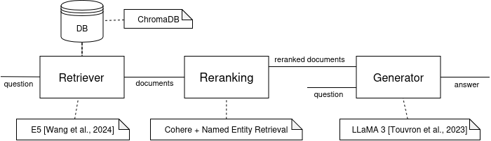
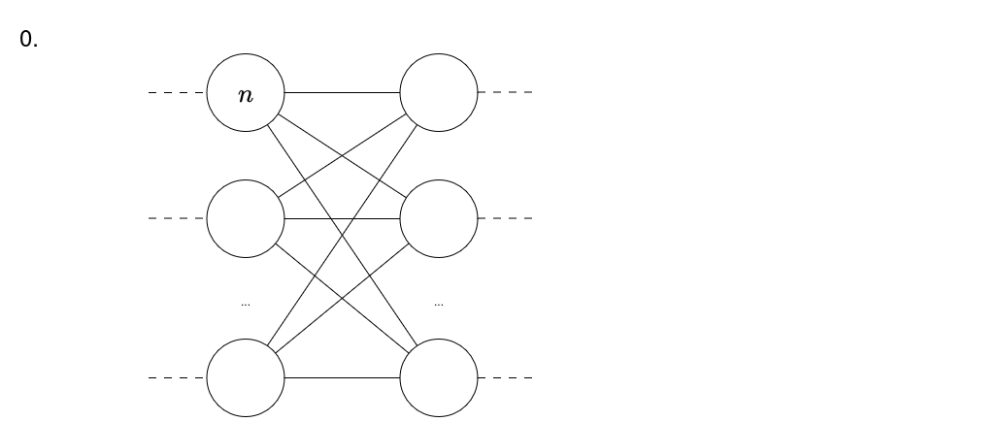
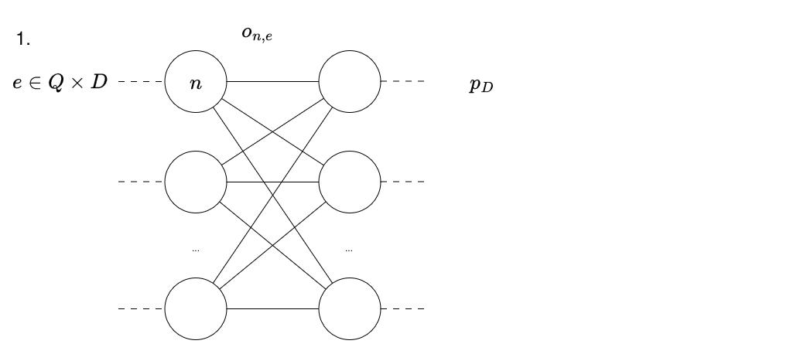
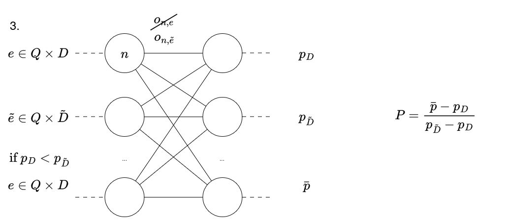
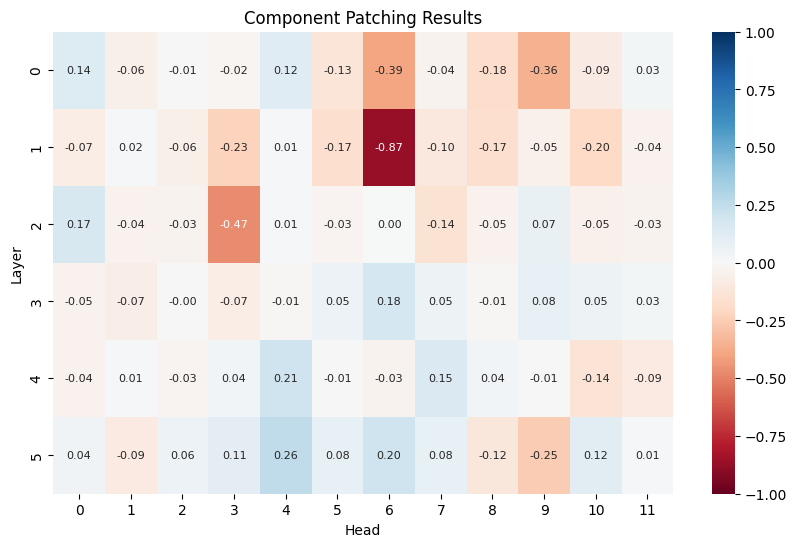
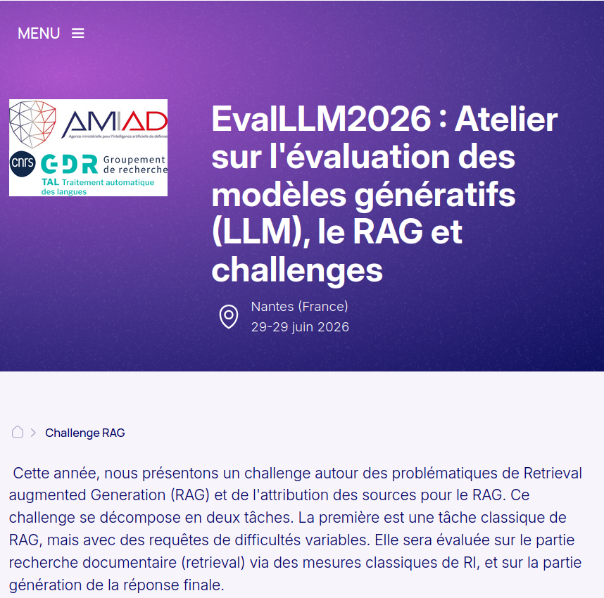

# Introduction & Context

## Retrieval Augmented Generation - RAG

### Retrieval Augmented Generation - Definition

_Add a knowledge database to a generative model_

- increase knowledge reliability
- release the burden of knowledge on the generator

. . . 

Tasks:

- _Knowledge intensive Generation tasks_
- Ex: Question Answering, Fact Checking, Dialogue, Retrieval

### Retrieval
Models includes Information Retrieval as a sub-task : Identify documents and informations useful to help generation

2 principal technologies:

- cross-encoder
- bi-encoder

$\Rightarrow$ Needs indexing before use


### RAG Architectures


![Simple RAG Architecture [@lewis_retrieval-augmented_2020]](images/DefRAG.drawio.png)  

. . . 

![Advanced RAG Architecture [@fan_survey_2024]](images/DefRAGAvance_integration.drawio.png)


### Examples

![RAG Architecture from [@tran_retrieval_2024]](images/RAGHN.drawio.png)




## Explainability in Artificial Intelligence

### Explainability in Artificial Intelligence

_Open black box models_

#### Aims

- Trustability
- Understandability
- Model Rectification

### Definitions

**XAI** : Make model's behavior understandable for human [@bell_its_2022]  
**Understand** : Predict model's behavior [@bell_its_2022]  
**Explanation** : Any way to make the decision process of the model understandable for human

:::: {.columns}

::: {.column width="40%"}
**Interpretability**  
_How ?_
:::

::: {.column width="40%"}

**Explanability**  
_Why ?_
:::

::::

### Explanation through creation of a model


## Mechanistic Interpretability

### Definition
> Reverse-engineer neural networks by identifying internal components (neurons, circuits, activation pathways, ...) that either contribute to or causally influence specific behaviors. [@somvanshi_bridging_2026]

Several approches:

- Manual Circuit Tracing 
- _Intervention-based Techniques_
- Representation Analysis
- Toy Models and Synthetic Tasks


### Activation Patching [@chen_axiomatic_2024] {.smaller}
Let $Q \times D \subset \mathcal{Q}\times\mathcal{D}$ be a set of pairs of questions and documents  
Let $Q \times \tilde{D}$ the same set of pairs but with perturbed documents  

:::{.incremental}

1. Forward pass all $Q\times D$
    - record $o_{i,j}^e$ the output of each component $n_{i,j}, \forall e \in Q\times D$
    - record $p_D$ the performance of the model
2. Forward pass all $Q\times \tilde{D}$
    - record $o_{i,j}^\tilde{e}$ the output of each component $n_{i,j}, \forall \tilde{e} \in Q\times \tilde{D}$
    - record $p_\tilde{D}$ the performance of the model  
3. Rewrite $D, e, \tilde{D} \text{ and } \tilde{e}$ as
    - $\hat{D}, \hat{e}, \check{D} \text{ and } \check{e}$ if $p_D > p_\tilde{D}$
    - $\check{D}, \check{e}, \hat{D} \text{ and } \hat{e}$ otherwise

:::

### Activation Patching [@chen_axiomatic_2024] {.smaller}

3. Rewrite $D, e, \tilde{D} \text{ and } \tilde{e}$ as
    - $\hat{D}, \hat{e}, \check{D} \text{ and } \check{e}$ if $p_D > p_\tilde{D}$
    - $\check{D}, \check{e}, \hat{D} \text{ and } \hat{e}$ otherwise


:::{.incremental}

4. For each component $n_{i,j}$ forward pass $Q\times\check{D}$ but replace $o_{i,j}^{\check{e}}$ by $o_{i,j}^{\hat{e}}$ for each $\check{e}$. Record the performance $\bar{p}$
5. $P = \frac{\bar{p} - p_\hat{D} }{p_\check{D} - p_\hat{D}}$ gives the impact of the perturbation on the model performance

:::

### Animation de l'execution de Activation patching (Step 0)



### Animation de l'execution de Activation patching (Step 1)



### Animation de l'execution de Activation patching (Step 2)


### Animation de l'execution de Activation patching (Step 3 and 4)


### Animation de l'execution de Activation patching (Step 3 and 4)



### MechIR [@parry_mechir_2025]

- Python library 
- Activation Patching
- Information retrieval models
- Charts sensibility of model components to a perturbation

```{python}
from mechir import Dot
from mechir.data import MechIRDataset, DotDataCollator
from mechir.perturb import perturbation
from mechir.plotting import plot_components

import torch
from torch.utils.data import DataLoader

import matplotlib.pyplot as plt
from matplotlib.ticker import MaxNLocator
import seaborn as sns

# Helper function to print query/baseline document/perturbed document triplets
def pretty_print_triplets(batch, tokenizer, num=1):
    """
    Pretty prints triplets of queries, documents, and their corresponding perturbed documents from a batch.

    Args:
        batch (dict): A dictionary containing 'queries', 'documents', and 'perturbed_documents' from a DataLoader.
        tokenizer: The tokenizer used to decode the input IDs.
        num (int): Number of examples to show per batch.
    """
    # Get the queries, documents, and perturbed documents from the batch
    queries = batch["queries"]
    documents = batch["documents"]
    perturbed_documents = batch["perturbed_documents"]

    # Loop through number of examples to show in batch
    for i in range(len(documents["input_ids"][:num])):
        # Get the input IDs
        query_ids = queries["input_ids"][i]
        original_ids = documents["input_ids"][i]
        perturbed_ids = perturbed_documents["input_ids"][i]

        # Decode the input IDs to text
        query_decoded = tokenizer.decode(query_ids.tolist(), skip_special_tokens=False).replace("[PAD]", "").strip()
        original_doc_decoded = tokenizer.decode(original_ids.tolist(), skip_special_tokens=False).replace("[PAD]", "").strip()
        perturbed_doc_decoded = tokenizer.decode(perturbed_ids.tolist(), skip_special_tokens=False).replace("[PAD]", "").strip()

        # Pretty print
        # print(f"Triplet {i + 1}:")
        print("Query:", query_decoded)
        print("Baseline Document:", original_doc_decoded)
        print("Perturbed Document:", perturbed_doc_decoded)
        print("=" * 50)  # Separator for clarity

# Helper function to calculate and store performances
def calculate_performance(model, dataloader, baseline_performance, perturbed_performance):
    for i, batch in enumerate(dataloader):
        # Get the queries, documents, and perturbed documents from the batch
        queries = batch["queries"]
        documents = batch["documents"]
        perturbed_documents = batch["perturbed_documents"]

        # Encode queries, baseline, and perturbed documents
        queries_encoded = model.forward(**queries)  # [batch_size x hidden_dim]
        baseline_encoded = model.forward(**documents)  # [batch_size x hidden_dim]
        perturbed_encoded = model.forward(**perturbed_documents)  # [batch_size x hidden_dim]

        # Calculate scores
        baseline_scores = torch.sum(queries_encoded.unsqueeze(1) * baseline_encoded.unsqueeze(0), dim=2)
        perturbed_scores = torch.sum(queries_encoded.unsqueeze(1) * perturbed_encoded.unsqueeze(0), dim=2)

        # Append flattened scores to the performance lists
        baseline_performance += baseline_scores.flatten().tolist()
        perturbed_performance += perturbed_scores.flatten().tolist()

# Helper function to plot score distributions between baseline and perturbed documents
def plot_score_dists_mult(all_baseline_scores, all_perturbed_scores, plot_type="hist"):
    # Number of subplots (one per perturbation type)
    num_plots = len(all_baseline_scores)

    # Set up the figure to hold multiple subplots in a single row
    fig, axs = plt.subplots(1, num_plots, figsize=(15, 4), sharey=True)
    fig.suptitle('Distribution of Baseline vs Perturbed Scores', fontsize=16)

    for idx, (perturb_type, ax) in enumerate(zip(all_baseline_scores.keys(), axs)):
        baseline_scores = all_baseline_scores[perturb_type]
        perturbed_scores = all_perturbed_scores[perturb_type]

        if plot_type == "hist":
            ax.hist(baseline_scores, label='Baseline', color='blue', alpha=0.5, bins=15)
            ax.hist(perturbed_scores, label='Perturbed', color='orange', alpha=0.5, bins=15)
            ax.yaxis.set_major_locator(MaxNLocator(integer=True))
            ax.set_ylabel('Frequency')
            ax.legend()
        elif plot_type == "kde":
            # Use seaborn for KDE plot, smoother distribution representation
            sns.kdeplot(baseline_scores, label='Baseline', color='#D55E00', fill=True, ax=ax, alpha=0.5)
            sns.kdeplot(perturbed_scores, label='Perturbed', color='#009E73', fill=True, ax=ax, alpha=0.5)
            ax.set_ylabel('Density')
            ax.legend()
        elif plot_type == "box":
            ax.boxplot([baseline_scores, perturbed_scores], tick_labels=['Baseline', 'Perturbed'])
            ax.set_ylabel('Scores')

        ax.set_xlabel('Scores')
        ax.set_title(f'{perturb_type.capitalize()}')

    plt.tight_layout(rect=[0, 0, 1, 0.95])  # Adjust layout to make space for the title
    plt.show()

    return

```


## Use case of my internship {.small}

_Use case_ : Domain specific language

Considering that activation patching charts the sensibility of a model to a perturbation

Hypothesis : 

- Models have **specific components dedicated to domain specific language**
- This domain specific language dedicated part of the model can be **charted with activation patching**
- That map can be used to **enhance model comprehension and robustness** of the domain specific language dedicated part of the model


```{python}
#| output: false
dot_model_name = "sebastian-hofstaetter/distilbert-dot-tas_b-b256-msmarco"
dot_model = Dot(dot_model_name)
```

```{python}
dataset = MechIRDataset("vaswani", query_id_subset=["1"])
``` 

# Method

### Building a perturbation
1. Identify domain specific language $L$ of the dataset
    - List words from each text
    - Calculate frequency and TF-IDF of each word
    - Find the domain specific language
2. Identify polysemic words $w$ that has a different meaning in everyday language 
3. Find a synonym $s$ of the everyday meaning of each $w$
4. Build perturbation $w \to s$

### Examples of perturbation

- solution -> answer
    - _microwave a measurements of dielectric absorption in dilute **solutions**_
    - _microwave a measurements of dielectric absorption in dilute answer_
- microwave -> toaster
    - _**microwave** a measurements of dielectric absorption in dilute solutions_
    - _**toaster** a measurements of dielectric absorption in dilute solutions_

``` {python}

@perturbation
def pert1(doc:str) -> str :
  return doc.replace("solution", "answer")

@perturbation
def pert2(doc:str) -> str:
  return doc.replace("microwave", "toaster")

``` 

```{python}
#|echo: false
pert1_dot_collator = DotDataCollator(dot_model.tokenizer, pert1, q_max_length=None, d_max_length=None, perturb_type="replace")
pert1_dot_dataloader = DataLoader(dataset, batch_size=16, collate_fn=pert1_dot_collator)

pert2_dot_collator = DotDataCollator(dot_model.tokenizer, pert2, q_max_length=None, d_max_length=None, perturb_type="replace")
pert2_dot_dataloader = DataLoader(dataset, batch_size=16, collate_fn=pert2_dot_collator)

print("REPLACE")
pretty_print_triplets(next(iter(pert2_dot_dataloader)), dot_model.tokenizer, num=2)

```


### Select useful Perturbation
5. Apply Activation Patching
6. Select relevant perturbations


```{python}
# Initialize lists to store baseline and perturbed performances for each dataloader
all_baseline_performance = {"solution -> answer": [], "microwave -> toaster": []}
all_perturbed_performance = {"solution -> answer": [], "microwave -> toaster": []}

# Calculate performances for each perturbation_type
calculate_performance(dot_model, pert1_dot_dataloader, all_baseline_performance["solution -> answer"], all_perturbed_performance["solution -> answer"])
calculate_performance(dot_model, pert2_dot_dataloader, all_baseline_performance["microwave -> toaster"], all_perturbed_performance["microwave -> toaster"])

plot_score_dists_mult(all_baseline_performance, all_perturbed_performance, plot_type="kde")
```


### Chart Model sensibility to the perturbation
7. Map the model sensibility to the perturbation



```{python}
# |eval: false
patching_head_outputs = []
for i, batch in enumerate(pert2_dot_dataloader):
    queries = batch["queries"]
    documents = batch["documents"]
    perturbed_documents = batch["perturbed_documents"]

    patch_head_out = dot_model.patch(queries, documents, perturbed_documents, patch_type="head_all")
    patching_head_outputs.append(patch_head_out)

mean_head_outputs = torch.mean(torch.stack([tens for tens,_ in patching_head_outputs]), axis=0)

print(mean_head_outputs)

plot_components(mean_head_outputs.detach().to("cpu").numpy())
```


### Finetune the Model 
8. Modify sensible weights 

WORK IN PROGRESS

# Experimentation

### Setup - Dataset

:::: {.columns}

::: {.column width="50%"}

- Extracted from EvalLLM2026 Challenge dataset
- French Defense dataset
- Pairs `(question, chunk of document)`
- 52 pairs, 26 questions

:::

::: {.column width="50%"}



:::

::::

### Setup - Model
E5-small [@wang_text_2022]

- Constrative bi-encoder 
- Pre-trained on unlabeled pairs (query, passage) CCPairs
- Finetuned with labelled pairs
- Based on MiniLM [@wang_minilmv2_2021]
- 33M params


### Setup - Mechanistic Interpretability Tools

Python libraries:

- MechIR [@parry_mechir_2025] 
- TransformerLens [@nanda_transformerlens_2022]

### First Results - Domain specific language identification
- Defense-specific language is prevalent

|Word      |Frequency| TF-IDF score      |
|---------|---|--------------------|
|militaire|26 |0.04494102684257385 |
|drone    |21 |0.04081921309724857 |
|article  |13 |0.0317659447734224  |
|défense  |9  |0.018444049962599192|
|emploi   |7  |0.017992160135997803|
|armée    |7  |0.0166576415296721  |
| ...     |...|...                 |

### First results - Perturbations in general
:::: {.columns}

:::{.column width="50%"}


:::

:::{.column width="50%"}


:::

::::

### First results - Best Perturbations {.smaller}
::::{.columns}
:::{.column width="50%"}


:::

:::{.column width="50%"}


- needs more complex perturbation (grammar, group of words)
- not enough

. . . 

LLMs target polysemy problem of models like Word2Vect

:::
::::

### Work left for the next 2,5 months

:::{.incremental}
- Identify new perturbations
    - new words and synonyms
    - new type of perturbation
- Chart the sensibility of the model to new perturbations
- Identify model modifications that enhance domain specific language comprehension/ use
:::


# Conclusion & Perspectives

### Conclusion

- H1 : Models have specific components dedicated to domain specific language
- H2 : This domain specific language dedicated part of the model can be charted with activation patching
- H3 : That map can be used to enhance model comprehension and robustness of the domain specific language dedicated part of the model

$\Rightarrow$ Work in Progress


### Other perturbations and linguistic structures
- subgroups of domain specific language
- temporal relationships
- negation
- expression of diachrony
- language switching

### Other use of the map

- Transfert learning
- Prunning
- Specialization of general models

## {.remerciements}

Thanks for you attention

Questions


### References

::: {#refs}
:::


