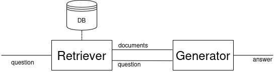

## Retrieval Augmented Generation - RAG

### Retrieval Augmented Generation - Definition

  

_Schema d'architecture plus avancée (avec augmentation avant et après retrieval + travail d'intégration de l'extraction dans le processus de génération)_

*Survey on RAG Meeting LLM: Towards Retrieval-Augmented Large Language Models [Fan et al., 2023]* {.footer}

### Approche plus théorique de retriever et generateur

_Retriever comme plongement des documents et questions dans un espace_

_Generateur comme fonction d'une paire (question, ensemble de documents) vers texte_

### Example

## Explainability in Artificial Intelligence

### Explainability in Artificial Intelligence

Aims:

- Trustability
- Understandability
- Model Rectification

### Definitions

**XAI** : Make model's behavior understandable for human [@bell_its_2022]  
**Understand** : Predict model's behavior [@bell_its_2022]  
**Explanation** : Any way to make decision process understandable for human

:::: {.columns}

::: {.column width="50%"}
Interpretability  
_How ?_
:::

::: {.column width="50%"}

Explanability  
_Why ?_
:::

::::

## Explanation through creation of a model

## MechIR [@parry_mechir_2025]

### MechIR [@parry_mechir_2025]

#### Mechanistic interpretability 
Understand the internal mechanisms of neural networks by performing
causal interventions on specific model components

#### MechIR
- Encoder-only models 
- For Information Retrieval

- Identify components responsible for some behavior
- Activation Patching Technique 

### Activation Patching [@chen_axiomatic_2024]
Let $\mathcal{D}$ be the set of documents and $\mathcal{Q}$ the set of questions  
Let $\mathcal{\tilde{D}}$ the perturbed documents  
For each component of the model:

1. _Étapes_
2. _D'execution_
3. _de la_
4. _méthode_

_Obtention du résultat + sens associé_

### Animation de l'execution de Activation patching

### Perturbation

Fonction qui pour chaque document, effectue la même modification.

Ici 1 type nous intéresse : remplacer un mot par un autre

#### Perturbation creation technique

- Identify vocabulary specific to the dataset 
- find in the vocabulary words with several meaning $m_D$ and $m_D$
- Replace that word by a synonym of the $m_D$ meaning

### What is a good perturbation 

- Have an impact of the documents representation
_Des images de courbes à ajouter ici_
- Be useful for interpretation

### Enhance a model with MechIR
TODO

---
---
# Brouillon
- Mechir
  - but et concept : cartographier les sensibilités des modèles encoder-based 
  - Activation Patching [Chen et al,. 2024]
    - Étapes
    - recul sur le résultat obtenu
  - Perturbation
    - Definition
    - approche de création par étude du vocabulaire important et utilisation des mots poly-sémantiques
    - 3 types de perturbation (append, prepend, replace) -> préférer replace
    - identifier une perturbation pertinente
  - Améliorer le modèle
    - Quelle modification effectuer?
    - 